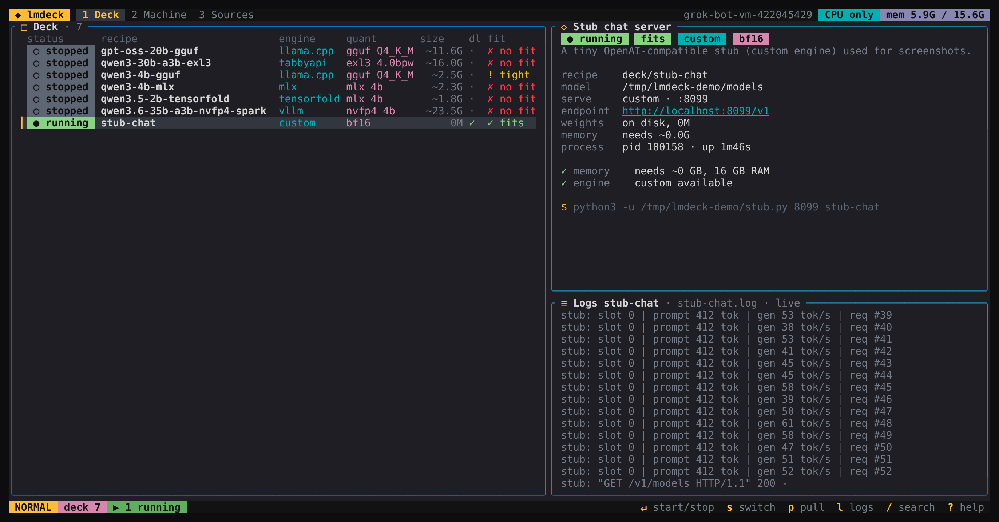
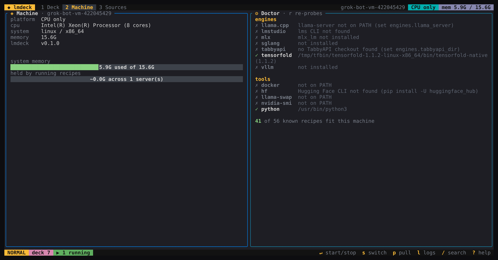

```
██╗     ███╗   ███╗██████╗ ███████╗ ██████╗██╗  ██╗
██║     ████╗ ████║██╔══██╗██╔════╝██╔════╝██║ ██╔╝
██║     ██╔████╔██║██║  ██║█████╗  ██║     █████╔╝
██║     ██║╚██╔╝██║██║  ██║██╔══╝  ██║     ██╔═██╗
███████╗██║ ╚═╝ ██║██████╔╝███████╗╚██████╗██║  ██╗
╚══════╝╚═╝     ╚═╝╚═════╝ ╚══════╝ ╚═════╝╚═╝  ╚═╝
```

**lmdeck** is a single-binary CLI for running local LLMs from *recipes*. A recipe
says which model to use, which quant, which engine, and what hardware it
needs. lmdeck shows what's downloaded and what's loaded, starts and stops
servers, searches recipe repos on GitHub and Hugging Face, and checks whether
a recipe fits the machine you're on.

Supported engines: **llama.cpp** (`llama-server`), **vLLM** (native or Docker),
**SGLang** (native or Docker), **TabbyAPI / exllamav3** (EXL3), **LM Studio**
(`lms`), **MLX** (`mlx_lm.server`), **TensorFold** (`tensorfold serve`, Metal + CUDA),
plus `custom` for anything with an
OpenAI-compatible `/v1/models`.

It reads [lmswitch](https://github.com/jvr0x/lmswitch) YAML recipes as-is, and
its default source is [`jvr0x/ai-models`](https://github.com/jvr0x/ai-models).

## Install

```sh
cargo install --git https://github.com/jvr0x/lmdeck
```

You need Rust 1.85 or newer. lmdeck runs on Linux and macOS, on both arm64 and
x86_64. Windows isn't supported.

## Quick start

```sh
lmdeck doctor                 # hardware, engines, and which recipes fit
lmdeck source update          # fetch recipes from github:jvr0x/ai-models
lmdeck recipe search qwen --compatible
lmdeck recipe add ai-models/qwen3.6-35b-a3b-nvfp4-fast
lmdeck pull qwen3.6-35b-a3b-nvfp4-fast     # hf download …
lmdeck use 1                  # start deck entry #1, wait for /v1/models
lmdeck list                   # ● loaded  ○ stopped  ✓ downloaded
lmdeck switch qwen3-4b-gguf   # stop the others, start this one
lmdeck stop --all
```

Run `lmdeck` with no arguments in a terminal to open the [TUI](#tui). When
stdout isn't a terminal, or with `--plain`, you get the wordmark and the deck
table instead, and can type a row number to toggle that recipe on or off.



## TUI

`lmdeck` (or `lmdeck tui`) opens a full-screen dashboard. Its look borrows from
[oh-my-pi](https://github.com/can1357/oh-my-pi): powerline segments, status
pills, rounded panels, and a status bar with key hints.

- **Deck**: your recipes with status pills (running, loading, stopped, pulling),
  download state (✓ on disk, ↓ pulling, · not yet) and fit (✓ fits, ! tight,
  ✗ no fit). Next to the list are a details pane with the checks and the exact
  launch command, and the live log of the selected recipe.
- **Machine**: platform, CPU and memory gauges, the memory held by running
  recipes, per-GPU memory, and which engines and tools are installed.
- **Sources**: the deck, the built-ins and every recipe source, with recipe
  counts and when each source was last fetched.

The screen refreshes every 2 s in the background. Starting, stopping and
pulling run off the UI thread, so nothing freezes while a server loads.
Quitting leaves servers running.

| key | action |
|---|---|
| `↑ ↓` / `j k`, `PgUp PgDn`, `g G` | move |
| `↵` / `space` | start or stop the selected recipe |
| `s` | switch: stop the others, start this one |
| `x` | stop |
| `p` | pull the weights (runs in the background; the log pane shows progress) |
| `l` | expand the log pane (`j k` then scroll it) |
| `/` | fuzzy search (`↵` keeps the filter, `esc` clears it) |
| `f` | only recipes that fit this machine |
| `a` | deck ↔ every known recipe |
| `1 2 3`, `tab` | deck · machine · sources |
| `t` | next theme |
| `r` | refresh now (re-probes engines) |
| `?` | help |
| `q`, `esc`, `ctrl-c` | quit |

Themes: `omp` (default, the oh-my-pi palette), `catppuccin` (mocha) and
`tokyo-night`. Pick one with `lmdeck tui --theme catppuccin` or
`LMDECK_THEME=tokyo-night`. If your terminal font is a Nerd Font, `--nerd` (or
`LMDECK_NERD_FONT=1`) draws rounded powerline caps on the pills.

| | |
|---|---|
|  |  |

## Web dashboard

```sh
lmdeck serve                    # http://127.0.0.1:7979/
lmdeck serve --port 8800
lmdeck serve --host 0.0.0.0 --token "$(openssl rand -hex 16)"   # see the warning below
```

`lmdeck serve` runs the same controls in a browser: a card for each recipe
with status, fit, size, a memory bar, checks and the launch command; Start /
Stop / Switch / Pull buttons; search and filters (fits, running, on disk);
machine, engine and source panels; and a live log drawer. The page and its
JSON API are compiled into the binary, so nothing is fetched from a CDN.


> [!WARNING]
> **Binding to anything other than localhost (for example `--host 0.0.0.0`)
> lets anyone who can reach that port start and stop servers and download
> models on this machine.** lmdeck refuses to do that without a token: if
> you don't pass `--token` (or set `LMDECK_TOKEN`), it generates one and
> prints the URL with it. There's no TLS, so on an untrusted network put it
> behind a reverse proxy with HTTPS, or use an SSH tunnel
> (`ssh -L 7979:127.0.0.1:7979 host`) and keep the default bind.

API (JSON unless noted):

| method | path | what it does |
|---|---|---|
| `GET` | `/api/health` | `{ok, version}`; never needs the token |
| `GET` | `/api/snapshot` | everything below in one document |
| `GET` | `/api/recipes` | every recipe, with status, download state, size, fit, checks and the launch command |
| `GET` | `/api/status` | running and deck recipes: status, port, endpoint |
| `GET` | `/api/doctor` | hardware, installed engines and tools, recipe parse errors |
| `GET` | `/api/sources` | the deck, built-ins and sources with recipe counts |
| `GET` | `/api/logs/{recipe}?n=200` | the tail of the server (or pull) log |
| `GET` | `/api/logs/{recipe}/stream` | Server-Sent Events: a `reset` event, then one `data:` line per log line |
| `POST` | `/api/start/{recipe}` · `/api/switch/{recipe}` · `/api/stop/{recipe}` · `/api/pull/{recipe}` | runs the action and returns `{ok, message}`; a refused action is `409` with `{ok:false, error}`. Optional body `{"force": true}` skips the fit checks. |

`{recipe}` is a name or an `origin/name` reference. Start and switch return as
soon as the server process is launched; poll `/api/status` to see it come up.

Guards:

- `POST` requests need an `X-Lmdeck: 1` header. A cross-site form or ``
  can't add one.
- When bound to loopback, the `Host` header must be `localhost`, `127.0.0.1`
  or `[::1]`. That blocks DNS-rebinding pages.
- With a token, every `/api` route except `/api/health` needs
  `Authorization: Bearer <token>` or `?token=<token>` (for EventSource). The
  dashboard reads the token from the `#token=` part of the URL it prints and
  keeps it in the browser's local storage.

```sh
curl -s localhost:7979/api/status
curl -s -X POST -H 'X-Lmdeck: 1' localhost:7979/api/switch/qwen3-4b-gguf
curl -N localhost:7979/api/logs/qwen3-4b-gguf/stream
```

The screenshots come from a CPU-only Linux VM. The running recipe is a small
`custom` stub server, and its log lines are synthetic.

## Commands

| command | what it does |
|---|---|
| `lmdeck list [-a] [-l] [-d] [--json]` | Shows the deck with status (●/◐/○), download state (✓/✗), size and port. `-a` lists every known recipe, `-l` only running servers, `-d` the weights on disk (models dir and HF cache). |
| `lmdeck use <ref\|#> [--only] [--no-wait] [--force] [--dry-run]` | Starts a recipe. The aliases `on` and `start` do the same. Before launching it checks compatibility, the engine, free memory and the port. `--dry-run` prints the exact command and runs nothing. |
| `lmdeck switch <ref\|#>` | Same as `use --only`: stops every other lmdeck server first. |
| `lmdeck stop <ref\|#>` / `--all` | Stops a server. lmdeck sends SIGTERM to the process group and SIGKILL after 20 s. Docker recipes get `docker stop`, LM Studio gets `lms unload`. |
| `lmdeck pull <ref> [--dry-run]` | Downloads the weights with `hf download` (or `huggingface-cli`), passing `--revision`, `--include` and `--local-dir` as needed. LM Studio recipes use `lms get` instead; TensorFold recipes use `tensorfold pull <repo>@<revision>`. |
| `lmdeck logs <ref> [-n N]` | Prints the tail of the server log. |
| `lmdeck recipe search [words] [--engine E] [--quant Q] [--compatible] [--source S] [--json]` | Searches the deck, the built-ins and every source, with a fit column (✓ ok, ! warning, ✗ won't fit). |
| `lmdeck recipe add <ref\|file\|url> [--name N] [--force]` | Copies a recipe into your deck as TOML. |
| `lmdeck recipe list [--source S]` / `show <ref> [--toml]` / `run <ref>` / `remove <name>` | Lists, inspects, runs or removes recipes. `run` starts a recipe without adding it to the deck. |
| `lmdeck source add <spec> [--name N] [--no-fetch]` / `list` / `update [name]` / `remove <name>` | Manages recipe sources. |
| `lmdeck doctor [--json]` | Shows the platform (GB10, Apple Silicon, NVIDIA, CPU), memory, GPUs and compute capability, which engines are installed, paths, sources, and a per-recipe fit table. |
| `lmdeck init [--models-dir DIR]` | Writes `~/.config/lmdeck/config.toml`. |
| `lmdeck tui [--theme T] [--nerd] [-a]` | Opens the full-screen TUI. A bare `lmdeck` does the same in a terminal; `--plain` turns that off. |
| `lmdeck serve [--host H] [-p PORT] [--token T]` | Serves the web dashboard and JSON API. The default is `127.0.0.1:7979`. |

A `<ref>` can be a recipe name (`qwen3-4b-gguf`), an `origin/name` pair
(`ai-models/gpt-oss-20b`, `builtin/qwen3-4b-mlx`), or the `#` row number from
`lmdeck list`. When the same name exists in several places, the deck copy wins.

## Sources

```sh
lmdeck source add github:jvr0x/ai-models               # whole repo, default branch
lmdeck source add github:someone/recipes/spark@v2      # subdirectory at a ref
lmdeck source add https://github.com/o/r/tree/main/recipes
lmdeck source add hf:someone/lmdeck-recipes            # a Hugging Face model repo
lmdeck source add hf:datasets/someone/recipes@main     # …or a dataset repo
lmdeck source add ~/src/my-recipes                     # a local directory
```

Sources are fetched over public HTTPS endpoints only:

- **GitHub:** the git trees API (`api.github.com`), then `raw.githubusercontent.com` for the files.
- **Hugging Face:** `huggingface.co/api/.../tree`, then `/resolve/` for the files.

Only `.toml`, `.yaml` and `.yml` files are fetched. A source is capped at 500
files, and each file at 512 KB. Files that aren't recipes, like CI configs or
notes, are skipped without a warning. Recipes that fail to parse are listed by
`lmdeck doctor`.

If `GITHUB_TOKEN`/`GH_TOKEN` or `HF_TOKEN` is set, it's sent as an auth header
to raise rate limits and reach private repos. Tokens are never written to disk.

Each source is mirrored to `~/.cache/lmdeck/sources/<name>/`. Run
`lmdeck source update` to refresh the mirrors.

## Recipe format

lmdeck's own recipes are TOML. YAML with the same schema works too. A recipe's
name defaults to its file name.

```toml
display_name = "Qwen3 30B-A3B (EXL3 4.0bpw)"
description  = "Qwen3 30B-A3B MoE on TabbyAPI / exllamav3."
tags         = ["qwen3", "moe", "dgx-spark"]

[model]
source   = "hf"                            # "hf" (default) or "local"
repo     = "turboderp/Qwen3-30B-A3B-exl3"  # Hugging Face repo id
revision = "4.0bpw"                        # branch / tag / commit
files    = []                              # files or globs (GGUF: first = file to load)
# path   = "turboderp/Qwen3-30B-A3B-exl3-4.0bpw"  # relative to models_dir, or absolute
size_gb  = 16.0                            # used for memory estimates

[quant]
format = "exl3"                            # gguf, exl3, exl2, nvfp4, mxfp4, fp8, awq, gptq, mlx, bf16 …
bits   = 4.0
label  = "4.0bpw"

[engine]
name  = "tabbyapi"     # llama.cpp | vllm | sglang | tabbyapi | lmstudio | mlx | tensorfold | custom
port  = 5000
ctx   = 32768
args  = ["--cache-mode", "Q8"]            # appended last; placeholders below
# env        = { CUDA_VISIBLE_DEVICES = "0" }
# image      = "vllm/vllm-openai:cu130-nightly"   # vllm/sglang: run in Docker
# entrypoint = ["vllm", "serve"]                  # docker --entrypoint override
# volumes    = ["/data:/data:ro"]
# bin        = "/opt/llama.cpp/build/bin/llama-server"
# dir        = "~/tabbyAPI"                       # tabbyapi checkout
# command    = ["my-server", "--port", "{port}"]  # custom engines
# ready_timeout = 900

[hardware]             # all optional
min_memory_gb = 24     # unified memory (GB10, Apple), VRAM (discrete GPUs) or RAM (CPU)
accelerator   = ["nvidia"]   # nvidia | apple | amd | cpu
os            = ["linux"]    # linux | macos
arch          = []           # aarch64 | x86_64
min_compute_capability = "10.0"   # e.g. NVFP4 needs Blackwell (GB10 = 12.1)
nodes         = 1
```

Placeholders in `args` and `command`: `{name}`, `{port}`, `{ctx}`, `{model}`,
`{models_dir}`, `{host}`, `{repo}`, `{revision}`.

If `args` already sets one of lmdeck's default flags (for example
`--n-gpu-layers` or `--gpu-memory-utilization`), lmdeck doesn't add its
default.

### What each engine runs

| engine | command (simplified) |
|---|---|
| `llama.cpp` | `llama-server --model <models_dir>/<repo>/<file> --alias <name> --host --port --ctx-size …`. If the GGUF isn't on disk, it uses `--hf-repo <repo> --hf-file <file>` instead. |
| `vllm` | Native: `vllm serve <repo or path> --served-model-name <name> --host --port --max-model-len [--revision]`. With `image`, it runs `docker run --rm --name lmdeck-<name> --gpus all --network host --ipc host` with the HF cache mounted. `HF_TOKEN` is forwarded by name only. |
| `sglang` | `python3 -m sglang.launch_server --model-path … --served-model-name … --context-length …`, natively or in Docker. |
| `tabbyapi` | `python3 main.py --model-dir … --model-name … --backend exllamav3 --max-seq-len …`, run in the TabbyAPI checkout. Weights must be local: `lmdeck pull` puts EXL3 branches in `<models_dir>/<repo>-<revision>`. |
| `lmstudio` | `lms server start`, then `lms load <model> --identifier <name>`. `stop` runs `lms unload`. |
| `mlx` | `mlx_lm.server --model <repo or path> --host --port`. |
| `tensorfold` | `tensorfold serve <repo or checkpoint dir> --name <name> --host --port [--context <ctx>]`. See [TensorFold](#tensorfold) below. |
| `custom` | Your `command`. |

### TensorFold

[TensorFold](https://github.com/ashhart/TensorFold) (Apache-2.0, by ashhart) is an
LLM inference server built as one Zig binary. It runs Metal kernels on Apple-silicon Macs
and CUDA kernels on Linux NVIDIA GPUs (x86_64, or aarch64 for GB10 / DGX Spark). It needs
no Python or MLX. It serves an OpenAI-compatible API (chat completions, completions,
Responses) and Anthropic Messages. `GET /v1/models` lists the `--name` you serve, so
lmdeck's readiness and status checks work as they do for the other engines. It is not
on PyPI.

- **Install:** `curl -fsSL https://tensorfold.dev/install.sh | sh` puts it in
  `~/.tensorfold/bin`. On a Mac, `brew install ashhart/tensorfold/tensorfold`. You can
  also unpack a [release archive](https://github.com/ashhart/TensorFold/releases), which
  on Linux ships the binary as `tensorfold-native`. `lmdeck doctor` finds `tensorfold`,
  `tensorfold-native` or `~/.tensorfold/bin/tensorfold`, and shows its version. Set
  `engines.tensorfold` if yours is somewhere else.
- **Weights:** TensorFold never downloads when it starts. Run `lmdeck pull <recipe>`
  first. That runs `tensorfold pull <repo>[@<revision>]`, which fills the Hugging Face
  cache, checks each file against the Hub, and refuses model types TensorFold has no
  native family for. `lmdeck use` refuses a TensorFold recipe whose weights aren't
  cached yet. A local checkpoint directory (`source = "local"`, `path = …`) is served
  directly.
- **Formats:** TensorFold serves its own model families: Qwen3.5/3.6/3.8, Nemotron,
  GLM, LFM, Gemma 4 and Kolibri. The checkpoint formats are MLX affine 4/6/8-bit, NVIDIA
  NVFP4, block FP8 and BF16. EXL3/TR3 and EXLR8 work only on the multi-machine
  setups listed in TensorFold's README. lmdeck's fit check fails `gguf`, `exl2`, `awq`
  and `gptq` recipes on this engine. It also fails any machine that isn't an
  Apple-silicon Mac or Linux with an NVIDIA GPU. `tensorfold capabilities --json` lists
  exactly what your binary supports.
- **Flags:** lmdeck adds `--name`, `--host`, `--port` (default 8080) and `--context`,
  unless your `args` already set them. Put anything else in `args`, such as
  `--no-thinking`, `--parallel 8`, `--drafter <repo>`, `--prompt-cache-gib 8` or
  `--api-key-file <file>`. `stop` sends SIGTERM to the process group, like every
  native engine.

```toml
[model]
repo     = "mlx-community/Qwen3.5-2B-MLX-4bit"
revision = "93760be4f1f69842a46bc13dbdc0f19e291392a3"   # used by `pull`; serve takes the repo name

[quant]
format = "mlx"
bits   = 4.0

[engine]
name = "tensorfold"    # aliases: tf, tensorfold-native
port = 8086
ctx  = 8192
args = ["--no-thinking"]
```

### lmswitch compatibility

lmswitch YAML recipes are converted when loaded. The mapping:

- `runtime` becomes the engine:
  - `llama` → llama.cpp
  - `vllm` → vllm
  - `sglang` → sglang
  - `exllamav3` → tabbyapi
  - `*-dual` → `nodes = 2`
- `model: org/repo/file.gguf` becomes `repo` plus `files`. It also becomes `path`, resolved against `models_dir`, the same `~/models` layout lmswitch uses.
- These keys carry over into engine flags:
  - `gpu_layers`, `threads`, `batch`, `ubatch`, `mmproj`
  - llama.cpp's `fit` (defaults to `-fit off`, as in lmswitch)
  - `gpu_memory_utilization`, `max_num_seqs`, `enforce_eager`
  - `tool_call_parser`, `reasoning_parser`, `trust_remote_code`
  - `image`, `entrypoint`, `env`, `extra_mounts`, `extra_args`
- The recipe description comes from the file's first comment line.

Multi-node (`*-dual`) recipes are listed and checked, but v0.1 refuses to
launch them. Use lmswitch for those.

## Files

| what | where |
|---|---|
| config | `~/.config/lmdeck/config.toml` (`$XDG_CONFIG_HOME`) |
| your deck | `~/.config/lmdeck/recipes/*.toml` |
| source mirrors | `~/.cache/lmdeck/sources/` (`$XDG_CACHE_HOME`) |
| run records and logs | `~/.local/state/lmdeck/{run,logs}/` (`$XDG_STATE_HOME`) |
| model weights | `models_dir` (default `~/models`, or `$LMDECK_MODELS_DIR`) plus the Hugging Face cache |

Set `LMDECK_HOME=/some/dir` to put all of lmdeck's files under one directory.
The tests use this. macOS uses the same XDG layout.

```toml
# ~/.config/lmdeck/config.toml
models_dir = "~/models"
host = "0.0.0.0"

[engines]                 # only needed when auto-detection misses something
# llama_server = "~/llama.cpp/build/bin/llama-server"
# tabbyapi_dir = "~/tabbyAPI"
# python = "~/venvs/vllm/bin/python"
# lms = "~/.lmstudio/bin/lms"
# tensorfold = "~/.tensorfold/bin/tensorfold"
# docker = "docker"

[[sources]]
name = "ai-models"
spec = "github:jvr0x/ai-models"
```

## Built-in examples

These recipes ship inside the binary. `lmdeck list` shows them while your deck
is empty. Every Hugging Face id below was checked against the Hub.

| recipe | model | engine | for |
|---|---|---|---|
| `qwen3-4b-gguf` | `unsloth/Qwen3-4B-GGUF` · Q4_K_M | llama.cpp | anything, ~2.5 GB |
| `gpt-oss-20b-gguf` | `unsloth/gpt-oss-20b-GGUF` · Q4_K_M | llama.cpp | 16 GB+ |
| `qwen3-30b-a3b-exl3` | `turboderp/Qwen3-30B-A3B-exl3` @ 4.0bpw | tabbyapi | NVIDIA / DGX Spark |
| `qwen3.6-35b-a3b-nvfp4-spark` | `nvidia/Qwen3.6-35B-A3B-NVFP4` | vllm (Docker) | DGX Spark / Blackwell |
| `qwen3-4b-mlx` | `mlx-community/Qwen3-4B-4bit` | mlx | Apple Silicon |
| `qwen3-4b-lmstudio` | `unsloth/Qwen3-4B-GGUF` | lmstudio | LM Studio |
| `qwen3.5-2b-tensorfold` | `mlx-community/Qwen3.5-2B-MLX-4bit` @ `93760be` | tensorfold | Apple Silicon or NVIDIA (TensorFold's quick-start model) |
| `qwen3.6-35b-a3b-mtp-tensorfold-spark` | `TensorFold/Qwen3.6-35B-A3B-MLX-4bit-MTP` @ `81169a9` | tensorfold | NVIDIA / DGX Spark (CUDA only) |

## Development

```sh
cargo build --release
cargo test                      # unit and integration tests, no network needed
cargo clippy --all-targets -- -D warnings
cargo fmt --check
```

## License

MIT
