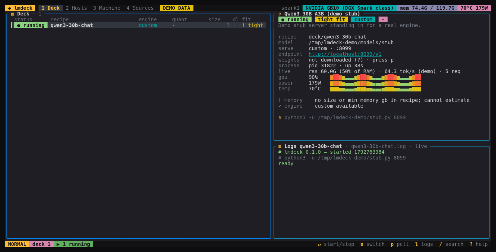
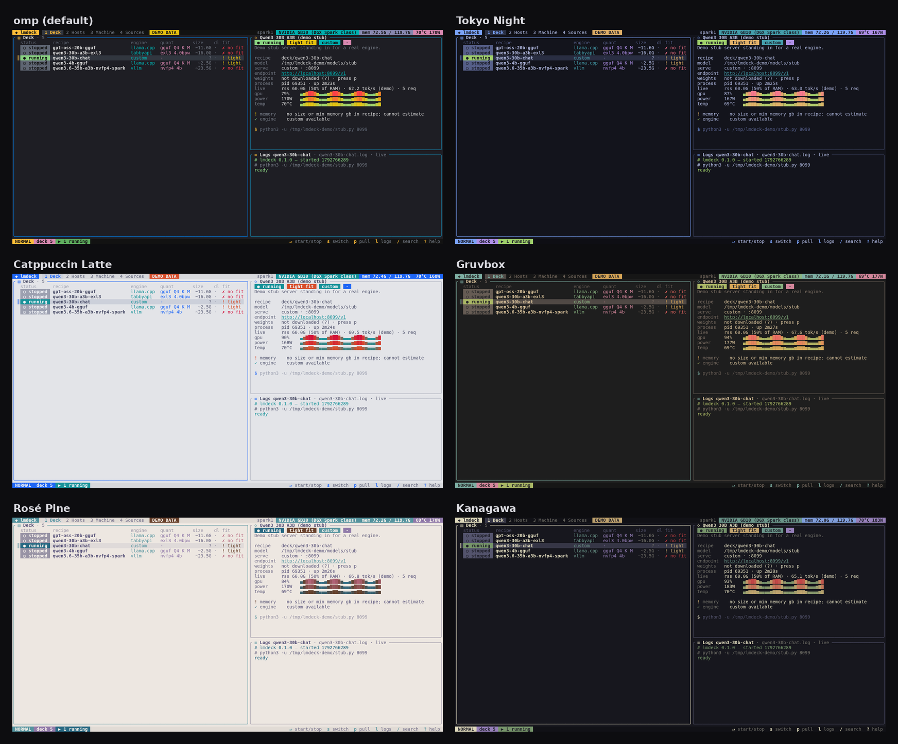
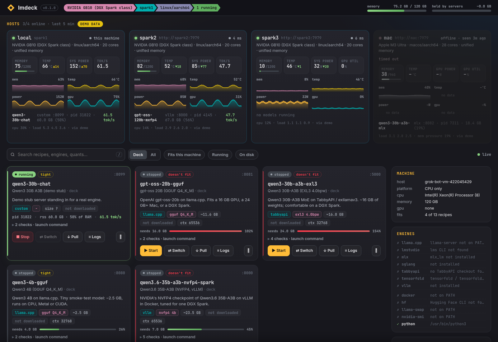

```
██╗     ███╗   ███╗██████╗ ███████╗ ██████╗██╗  ██╗
██║     ████╗ ████║██╔══██╗██╔════╝██╔════╝██║ ██╔╝
██║     ██╔████╔██║██║  ██║█████╗  ██║     █████╔╝
██║     ██║╚██╔╝██║██║  ██║██╔══╝  ██║     ██╔═██╗
███████╗██║ ╚═╝ ██║██████╔╝███████╗╚██████╗██║  ██╗
╚══════╝╚═╝     ╚═╝╚═════╝ ╚══════╝ ╚═════╝╚═╝  ╚═╝
```

**lmdeck** is a single-binary CLI for running local LLMs from *recipes*. A recipe
says which model to use, which quant, which engine, and what hardware it
needs. lmdeck shows what's downloaded and what's loaded, starts and stops
servers, searches recipe repos on GitHub and Hugging Face, and checks whether
a recipe fits the machine you're on.

Supported engines: **llama.cpp** (`llama-server`), **vLLM** (native or Docker),
**SGLang** (native or Docker), **LMDeploy** (native or Docker), **TabbyAPI /
exllamav3** (EXL3), **LM Studio** (`lms`), **MLX** (`mlx_lm.server`), **TensorFold**
(`tensorfold serve`, Metal + CUDA), plus `custom` for anything with an
OpenAI-compatible `/v1/models`.

`custom` can also *wrap* a repo that already ships its own `start.sh` / `stop.sh`
(see [Wrapped recipes](#wrapped-recipes)). lmdeck clones it, runs its scripts and
watches the server. It never patches or builds an engine itself.

Recipes are TOML only.

## Install

```sh
cargo install --git https://github.com/javierbits/lmdeck
```

You need Rust 1.85 or newer. lmdeck runs on Linux and macOS, on both arm64 and
x86_64. Windows isn't supported.

## Quick start

```sh
lmdeck doctor                 # hardware, engines, and which recipes fit
lmdeck source add github:someone/recipes   # optional: more recipes
lmdeck recipe search qwen --compatible
lmdeck recipe add qwen3-4b-gguf
lmdeck pull qwen3-4b-gguf     # hf download …
lmdeck use 1                  # start deck entry #1, wait for /v1/models
lmdeck list                   # ● loaded  ○ stopped  ✓ downloaded
lmdeck switch qwen3-4b-gguf   # stop the others, start this one
lmdeck stop --all
```

Run `lmdeck` with no arguments in a terminal to open the [TUI](#tui). When
stdout isn't a terminal, or with `--plain`, you get the wordmark and the deck
table instead, and can type a row number to toggle that recipe on or off.


## First run

The first time an interactive lmdeck command starts (`lmdeck`, `tui`, `serve`,
`use`, `switch`, `list`, `init`), a short setup runs before anything else:

1. **This machine**: what was detected: platform, CPU, memory, GPUs, engines,
   and the ConnectX-7 / RDMA ports, then a
   "does this look right?" confirm.
2. **Model weights**: where `lmdeck pull` downloads to, shown with the free
   space on that filesystem (the default is `~/models`). Native engines that
   keep their own hub cache (tensorfold, mlx, lmstudio) ignore this, so set
   `HF_HOME` too if you want everything off the boot disk. Any time:
   `lmdeck init --models-dir /mnt/nvme/models`, `LMDECK_MODELS_DIR`, or the
   `models_dir` key in config.toml.
3. **The cluster**: the wizard looks for the other Sparks over the
   ConnectX-7 links only: the neighbours on each CX7 port (a sweep of the
   subnet when the neighbour table is silent) and the subnets routed through
   those ports, which is how a ring reaches the Spark across from it. Each
   address that answers on ssh or on `lmdeck serve` (port 7979) is grouped
   into one machine by its SSH host key, so two cables to the same Spark are
   one host, and named by its real hostname (read over ssh, or reported by
   `lmdeck serve`). With no hostname it asks; it never makes one up.

   The other machines must run `lmdeck serve`; without it they can't be
   driven or measured (see [docs/MULTIHOST.md](docs/MULTIHOST.md)). For each
   one that doesn't answer on 7979, the wizard offers to set it up over SSH
   on the CX7 address:
   - log in with keys only (`BatchMode`, which can't type a passphrase): when
     ssh's own choice is refused it tries each of your keys without a
     passphrase and keeps the one that works. If none is accepted it offers
     `ssh-copy-id -i` for the first one (your SSH password, typed into ssh
     itself), and makes a key first if you have none;
   - copy this lmdeck binary when the OS and CPU match, otherwise
     `cargo install --git https://github.com/javierbits/lmdeck` there;
   - write a new token to `~/.config/lmdeck/serve.env` there (mode 600, sent
     over stdin, never on a command line) and save it in `hosts.toml` here;
   - start `lmdeck serve --host <its CX7 address>`, as a systemd user service
     when you say so (`lmdeck-serve.service`, restarts on failure). To start
     it at boot it turns on `loginctl enable-linger`; if that needs sudo it
     asks for the password once, hidden, and passes it to `sudo -S` on stdin.
     It isn't saved or logged.
   - then checks that it answers, and adds the host under its hostname.


4. **Recipe sources**: repos that hold lmdeck recipe files (`.toml`), searched
   alongside the built-ins (`github:owner/repo`, `hf:owner/repo`, a URL, a
   local directory). There is no default source; the built-in recipes are
   always there. A model repo with its own start scripts isn't a source: run
   `lmdeck add <url>` for it instead.


Answers are saved to `~/.config/lmdeck/` (`hosts.toml`, `config.toml`) and
`[setup] done = true` keeps the wizard from asking again; `lmdeck setup` runs
it again (hosts and sources already there are kept). `LMDECK_NO_SYNC=1`

skips all first-run prompts; `lmdeck host add` and `lmdeck source add` do the
same jobs any time.

## TUI

`lmdeck` (or `lmdeck tui`) opens a full-screen dashboard. Its look borrows from
[oh-my-pi](https://github.com/can1357/oh-my-pi): powerline segments, status
pills, rounded panels, and a status bar with key hints.
- **Deck**: your recipes with status pills (running, loading, stopped, pulling),
  download state (✓ on disk, ↓ pulling, · not yet) and fit (✓ fits, ! tight,
  ✗ no fit). The list groups models by family under `── Qwen ──`-style
  separators (`F` toggles it; the web dashboard has a Group families button).
  Next to the list are a details pane with the checks and the exact
  launch command, and the live log of the selected recipe. A running recipe
  also shows its process RSS and share of RAM, VRAM on discrete GPUs, tok/s
  when the engine exposes metrics, and GPU / power / temperature sparklines.
- **Hosts**: live telemetry for this machine and every host in `hosts.toml`
  (see [Hosts and telemetry](#hosts-and-telemetry)): memory, temperature,
  power, GPU and CPU use and tok/s as bars with ▲/▼ change over the last
  minute, heat-coloured history columns, gauges and a few minutes of history
  for the selected host, and a detail strip with where each number came from.
  Offline hosts are greyed out with the error and when they were last seen.
  `←→` picks a model running on that host; `x` stops it, `l` shows its log,
  and `↵` / `s` start or switch the Deck tab's selected recipe **on that
  host** (see [docs/MULTIHOST.md](docs/MULTIHOST.md)).
- **Topology**: hosts with dot-art device icons, GPUs, cables and synthetic switches from the L2 graph
  (auto-detected, or `[[link]]` in hosts.toml), LAN / Tailscale fallbacks,
  the management links from this machine, and which links are busy carrying
  NFS weights or a multi-node run.
- **Machine**: platform, CPU and memory gauges, the memory held by running
  recipes, per-GPU memory, and which engines and tools are installed.
- **Sources**: the deck, the built-ins and every recipe source, with recipe
  counts and when each source was last fetched.

The screen refreshes every 2 s in the background. Starting, stopping and
pulling run off the UI thread, so nothing freezes while a server loads.
Quitting leaves servers running.

| key | action |
|---|---|
| `↑ ↓` / `j k`, `PgUp PgDn`, `g G` | move |
| `↵` / `space` | start or stop the selected recipe |
| `s` | switch: stop the others, start this one |
| `o` | run on another host: a picker with, per host, where the weights come from (here / read-only NFS over CX7), the link, a load-time estimate and the fit on that host |
| `x` | stop |
| `p` | pull the weights, or update a wrapped recipe's checkout (runs in the background; the log pane shows progress) |
| `u` | take a `⬆` upstream update; for a pinned wrapped recipe this also moves the pin (`pull --latest`) |
| `l` | expand the log pane (`j k` then scroll it) |
| `/` | fuzzy search (`↵` keeps the filter, `esc` clears it) |
| `f` | only recipes that fit this machine |
| `a` | deck ↔ every known recipe |
| `1`–`5`, `tab` | deck · hosts · topology · machine · sources (on Hosts, `↑ ↓` picks a host, `← →` a model on it, `↵`/`s`/`x`/`l` act there) |
| `t` | next theme (saved to config) |
| `T` | theme picker: `↑ ↓` previews live, `↵` saves, `esc` reverts |
| `r` | refresh now (re-probes engines) |
| `F` | group the deck by model family (`── Qwen ──` sections; `Qwen`, `GLM`, `DeepSeek`, …) — on again to flatten |
| `q`, `esc`, `ctrl-c` | quit |

If your terminal font is a Nerd Font, `--nerd` (or `LMDECK_NERD_FONT=1`)
draws rounded powerline caps on the pills. Themes are covered [below](#themes).


| | |
|---|---|
|  | |
|  |  |

## Themes

lmdeck has 24 themes: its own `omp` (the default, the oh-my-pi palette) and
every theme that ships with [Omarchy](https://omarchy.org/): Catppuccin,
Catppuccin Latte, Ethereal, Everforest, Flexoki Light, Gruvbox, Hackerman,
Kanagawa, Last Horizon, Lumon, Lupine, Matte Black, Miasma, Nord, Osaka Jade,
Retro 82, Ristretto, Rosé Pine, Solitude, Starship, Tokyo Night, Vantablack
and White. The TUI and the web dashboard use the same theme.

```sh
lmdeck theme list               # every theme with swatches; ● marks the current one
lmdeck theme set rose-pine      # saved as `theme = "rose-pine"` in config.toml
lmdeck theme show [name]        # its colours, by role, and where they come from
lmdeck theme sync-omarchy       # use the theme Omarchy is currently on
lmdeck theme reset              # back to omp
```

Theme names are forgiving: `"Rosé Pine"`, `rose-pine`, `ROSE PINE` and `rose`
all mean the same theme. In the TUI, `t` cycles through the themes and `T`
opens a picker with swatches and a live preview. Both save your choice. In the
browser, the swatch menu in the top bar applies a theme straight away and saves
it to the same config file. If saving fails, for example on a read-only config,
the choice is kept in that browser only. `?theme=nord` in the URL previews a
theme without saving it. To use a theme for one run only, pass
`lmdeck tui --theme nord` or set `LMDECK_THEME=nord`. Either one takes
priority over the saved theme.



| | |
|---|---|
|  |  |

The colours are Omarchy's, copied verbatim from
[`themes/<name>/colors.toml`](https://github.com/omacom/omarchy/tree/967bbdd7346e6e2ff1a6af33c5d762ea784832cc/themes)
at commit `967bbdd` (the repo is now `omacom/omarchy`, formerly
`basecamp/omarchy`; MIT, © David Heinemeier Hansson; see [licenses/omarchy-MIT.txt](licenses/omarchy-MIT.txt)).
Each of lmdeck's roles (text, accent, ok, warning, error, borders, selection,
pills) takes the first colour in the theme's own palette that meets a contrast
threshold against the background: 4.5:1 for text and 3:1 for status colours.
This keeps light themes readable. No colour is invented (the web page only
adds translucent tints and gradient ends mixed from these colours), and the
tests check both rules for every theme. Monochrome themes such as White and
Vantablack therefore show status in greys, just like the originals. To
regenerate the table after Omarchy adds or changes a theme:

```sh
git clone https://github.com/omacom/omarchy /tmp/omarchy
python3 scripts/import-omarchy-themes.py /tmp/omarchy > src/theme/omarchy.rs
```

## Harness sync

When a recipe starts, lmdeck can also point your agent CLIs at it, the way
lmswitch does: every running server becomes a provider entry (or a
custom-provider lane) in the config of each harness you chose, with its own
`http://<host>:<port>/v1` base URL, display name and context window. When the
server stops, its entry goes away. Your own entries in those files are never
touched.

Supported harnesses: **OpenCode** (`~/.config/opencode/opencode.json`),
**omp** (`~/.omp/agent/models.yml`), **Grok** (`~/.grok/config.toml`),
**pi** (`~/.pi/agent/models.json`) and **Hermes** (`~/.hermes/config.yaml`).

The first time you run lmdeck in a terminal it asks which ones to sync with
(detected ones default to yes) and which hosts' running models to include;
the answers are saved to `[harness]` in config.toml. Change them later with
`lmdeck harness enable|disable <name>` and `lmdeck harness hosts all|none|NAME…`,
run a sync right now with `lmdeck harness sync`, or list what is detected with
`lmdeck harness`. `LMDECK_NO_SYNC=1` turns the whole thing off, and
`LMDECK_SYNC_HOST=<host>` overrides the host used in the written URLs (by
default the config `host` when it is a specific address, else
`<hostname>.local`, so the URLs also resolve from other machines on the LAN).

Models running on your other machines are included too: every configured host
(hosts.toml) is asked what it is serving, and its running models become lanes
in the same configs, pointed at that host's address — spark2's models show up
in sparkA's opencode without touching spark2. Each lane gets its own base
URL; remote lanes are tagged with the host (`glm5.3-flash [Spark2]` in grok).
An offline host just contributes nothing.

There is also an opt-in mirror: `lmdeck harness export on` writes the same
`opencode.json` payload to `~/.local/share/opencode-export/` — the copy a
second machine's pull job can fetch over HTTP (lmdeck serves nothing for
this itself). Off by default; `lmdeck harness` shows its state.

## Web dashboard

```sh
lmdeck serve                    # http://127.0.0.1:7979/
lmdeck serve --port 8800
lmdeck serve --host 0.0.0.0 --token "$(openssl rand -hex 16)"   # see the warning below
```

`lmdeck serve` runs the same controls in a browser: a card for each recipe
with status, fit, size, a memory bar, checks and the launch command; Start /
Stop / Switch / Pull buttons (wrapped recipes with new upstream commits get a
`⬆ update` badge and an `⬆ Update` button); search and filters (fits, running, on disk);
machine, engine and source panels; a live log drawer; and a Hosts row with
one card per host (memory, temperature, power, tok/s, sparklines, the
running models) that updates every 2.5 s. The page and its
JSON API are compiled into the binary, so nothing is fetched from a CDN.


Across machines (details in [docs/MULTIHOST.md](docs/MULTIHOST.md)): host cards
have `≡` logs and `■` stop per model and a **run here** picker; recipe cards
show **⛁ weights on: …**, `×N nodes` with the start order for multi-node
recipes, and a **Run on another host…** dropdown that opens the plan (NFS
steps, link, load estimate, fit) before anything starts; a **Topology**
section draws the hosts and their CX7 / LAN / Tailscale links as an SVG.

| | |
|---|---|
|  |  |
|  |  |

> [!WARNING]
> **Binding to anything other than localhost (for example `--host 0.0.0.0`)
> lets anyone who can reach that port start and stop servers and download
> models on this machine.** lmdeck refuses to do that without a token: if
> you don't pass `--token` (or set `LMDECK_TOKEN`), it generates one and
> prints the URL with it. There's no TLS, so on an untrusted network put it
> behind a reverse proxy with HTTPS, or use an SSH tunnel
> (`ssh -L 7979:127.0.0.1:7979 host`) and keep the default bind.

API (JSON unless noted):

| method | path | what it does |
|---|---|---|
| `GET` | `/api/health` | `{ok, version}`; never needs the token |
| `GET` | `/api/snapshot` | everything below in one document |
| `GET` | `/api/recipes` | every recipe, with status, download state, size, fit, checks and the launch command |
| `GET` | `/api/status` | running and deck recipes: status, port, endpoint |
| `GET` | `/api/doctor` | hardware, installed engines and tools, recipe parse errors |
| `GET` | `/api/sources` | the deck, built-ins and sources with recipe counts |
| `GET` | `/api/telemetry?history=1&since=MS` | this machine's live telemetry (memory, GPUs, temperatures, power, load, running models with RSS and tok/s); with `history=1` also the samples newer than `since` (ms since the epoch) |
| `GET` | `/api/hosts` | `{at, demo, hosts:[…]}`: this machine plus every host in `hosts.toml`, each with `online`, `error`, `latency_ms`, `last_seen`, `telemetry` and `history` |
| `GET` | `/api/logs/{recipe}?n=200` | the tail of the server (or pull) log |
| `GET` | `/api/logs/{recipe}/stream` | Server-Sent Events: a `reset` event, then one `data:` line per log line |
| `POST` | `/api/start/{recipe}` · `/api/switch/{recipe}` · `/api/stop/{recipe}` · `/api/pull/{recipe}` | runs the action and returns `{ok, message}`; a refused action is `409` with `{ok:false, error}`. Optional body `{"force": true}` skips the fit checks; `{"latest": true}` on `pull` moves a pinned wrapped recipe to the upstream head (`pull --latest`). |

`{recipe}` is a name or an `origin/name` reference. Start and switch return as
soon as the server process is launched; poll `/api/status` to see it come up.

Guards:

- `POST` requests need an `X-Lmdeck: 1` header. A cross-site form or ``
  can't add one.
- When bound to loopback, the `Host` header must be `localhost`, `127.0.0.1`
  or `[::1]`. That blocks DNS-rebinding pages.
- With a token, every `/api` route except `/api/health` needs
  `Authorization: Bearer <token>` or `?token=<token>` (for EventSource). The
  dashboard reads the token from the `#token=` part of the URL it prints and
  keeps it in the browser's local storage.

```sh
curl -s localhost:7979/api/status
curl -s -X POST -H 'X-Lmdeck: 1' localhost:7979/api/switch/qwen3-4b-gguf
curl -N localhost:7979/api/logs/qwen3-4b-gguf/stream
```

The screenshots come from a CPU-only Linux VM. The running recipe is a small
`custom` stub server, and its log lines are synthetic.

## Hosts and telemetry

Every `lmdeck serve` samples its own machine every 2 s and keeps about six
minutes of history in memory. Add the other machines to watch and the local
TUI and dashboard show them next to this one:

```sh
# on each DGX Spark / Mac: listen on the Tailscale (or LAN) address with a token
lmdeck serve --host 100.101.102.103 --token "$(openssl rand -hex 16)"

# on the machine you look from
lmdeck host add spark1 http://spark1:7979 --token <that token>
lmdeck host add spark2 http://spark2:7979 --token <…>
lmdeck host add mac    http://mac-studio:7979 --token <…>
lmdeck host list          # polls each one: ● online 4 ms / ○ offline · timed out
lmdeck host remove mac
```

Design:

- **Pull.** The local instance polls each host's
  `GET /api/telemetry?history=1&since=…` in parallel, every 2 s, with a
  1.5 s timeout. The first poll fetches the remote history, after that only
  the new samples.
- **Remote control.** Start, stop, switch and logs on another host go to
  that host's own `lmdeck serve`: `lmdeck use|switch|stop|logs … --on spark2`,
  the TUI Hosts tab, or the dashboard's host cards. A host only runs recipes
  it has by name unless it sets `[serve] accept_recipes = true`.
- **Multi-host** (weights on another host, running a model where its weights
  aren't, `[[nodes]]` recipes across Sparks, CX7 detection, topology): see
  **[docs/MULTIHOST.md](docs/MULTIHOST.md)**.
- **`hosts.toml`** lives in the config dir (`~/.config/lmdeck/hosts.toml`):
  `[[host]] name / url / token` (or `token_env = "VAR"`, or
  `LMDECK_HOST_TOKEN_<NAME>` in the environment), optional `link_addr`, and
  `[[link]]` overrides. lmdeck writes it with mode `0600` because
  it holds tokens. It's re-read every round, so edits apply without a
  restart. Keep it out of git.
- **Tokens** go out as `Authorization: Bearer <token>`, per host. A wrong
  token shows as `unauthorized: wrong or missing token`. There's no TLS
  beyond what the URL gives you, so use Tailscale, a VPN, or an HTTPS
  reverse proxy, never a public port.
- **Offline hosts** stay listed, greyed out, with the error (`connection
  refused`, `timed out`, an HTTP status) and their last numbers and when they
  were last seen.

What gets measured, and where it comes from:

| what | Linux / DGX Spark (GB10) | NVIDIA discrete GPUs | macOS (no sudo) |
|---|---|---|---|
| memory | `/proc/meminfo` (`MemTotal − MemAvailable`). On GB10 this is the unified CPU+GPU pool. | same, plus VRAM from `nvidia-smi` | `vm_stat` + `sysctl hw.memsize`, `kern.memorystatus_level` as pressure |
| GPU temp, power, util, SM clock | `nvidia-smi --query-gpu`. GB10 reports `[N/A]` for memory and the power limit; those become blanks, not zeros. | `nvidia-smi` | not available without sudo; `LMDECK_POWERMETRICS=1` tries `sudo -n powermetrics` (off by default) |
| CPU temp | hwmon: `spbm` (the [spark_hwmon](https://github.com/antheas/spark_hwmon) driver) if loaded, else `k10temp` / `coretemp` / ACPI thermal zones | same | – |
| system power | `spbm` `sys_total` / `dc_input` if loaded; otherwise the GPU's draw. NVIDIA doesn't expose CPU power on GB10. | GPU draw | powermetrics (opt-in) |
| CPU use, load | `/proc/stat`, `/proc/loadavg` | same | `sysctl vm.loadavg` |
| per model | PID from the run record, RSS of its process tree (`ps`), its share of RAM, VRAM from `nvidia-smi --query-compute-apps` | same | RSS and share |
| tok/s | the engine's Prometheus `/metrics`: vLLM `vllm:generation_tokens_total`, SGLang `sglang:generation_tokens_total`, llama.cpp `llamacpp:tokens_predicted_total` (lmdeck adds `--metrics` to llama-server). A rate between two samples; otherwise "n/a". | same | same (MLX / LM Studio have no metrics, so n/a) |

Anything a machine doesn't report is shown as `–`, never guessed. Docker
recipes show tok/s (the metrics port is published) but no RSS, because the
container isn't in lmdeck's process tree.

### Demo mode

`LMDECK_DEMO=1` swaps every reading for **synthetic** numbers: a busy local
"spark1", spark2 (busy), spark3 (idle) and an offline Mac. It exists for
screenshots and UI work. The TUI header, the Hosts strip, `lmdeck host list`,
the dashboard and every JSON document (`"demo": true`) say **DEMO DATA**
while it's on. The Hosts and deck-telemetry screenshots above, and the
dashboard one below, were taken in demo mode on a CPU-only VM. The fit
column and Machine panel there still describe that VM.



## Commands

| command | what it does |
|---|---|
| `lmdeck list [-a] [-l] [-d] [--json] [--flat]` | Shows the deck with status (●/◐/○), download state (✓/✗), size and port, grouped under `── Family ──` separators (Qwen, GLM, DeepSeek, …; `--flat` disables the grouping). `-a` lists every known recipe, `-l` only running servers, `-d` the weights on disk (models dir and HF cache). |
| `lmdeck use <ref\|#> [--only] [--no-wait] [--force] [--dry-run]` | Starts a recipe. The aliases `on` and `start` do the same. Before launching it checks compatibility, the engine, free memory and the port. `--dry-run` prints the exact command and runs nothing. |
| `lmdeck switch <ref\|#>` | Same as `use --only`: stops every other lmdeck server first. |
| `lmdeck stop <ref\|#>` / `--all` | Stops a server. lmdeck sends SIGTERM to the process group and SIGKILL after 20 s. Docker recipes get `docker stop`, LM Studio gets `lms unload`, wrapped recipes run their `stop` script first. |
| `lmdeck pull <ref> [--latest] [--dry-run]` | Downloads the weights with `hf download` (or `huggingface-cli`), passing `--revision`, `--include` and `--local-dir` as needed. LM Studio recipes use `lms get` instead; TensorFold recipes use `tensorfold pull <repo>@<revision>`. For a recipe with a `[source]`, it fetches the checkout and checks out its `ref` again (and downloads nothing unless the recipe also has a `[model]` repo). `--latest` first moves a pinned `ref` to the upstream head, rewriting the deck recipe. |
| `lmdeck outdated [names] [--fetch] [--json]` | Asks each cloned wrapped recipe's upstream (`git ls-remote`, no fetch) whether it has new commits, and prints local and remote commits and what to run. `--fetch` also fetches into the checkout so it can count the commits behind. Alias `updates`. See [Update checks](#update-checks). |
| `lmdeck browse [words] [-t TAG]… [--sort name\|sparks\|speed] [--fits] [--refresh\|--offline] [--json]` | Lists the [recipe index](#recipe-index) with installed state, update badge, fit and the speed each repo reports. Words match name, description and tags; `-t exl3` or `-t sparks=2` filters by tag. |
| `lmdeck add <name>` | Installs an index entry by name: its native recipe if it has one, otherwise it wraps the repo like `add <repo>`. A typo gets `did you mean: …`. |
| `lmdeck add <repo> [--name N] [--ref R] [--force]` | Wraps a repo that has `start.sh` and `stop.sh` at its root: clones it, reads the scripts, and writes a wrapper recipe into the deck. `<repo>` is `owner/repo`, a GitHub or git URL, or a local directory. See [Wrapped recipes](#wrapped-recipes). |
| `lmdeck logs <ref> [-n N] [--on HOST] [--node N]` | Prints the tail of the server log (of another host, or one node of a multi-node recipe). |
| `lmdeck use\|switch\|stop <ref> --on HOST [--allow-slow-link]` | Runs or stops it on another host. If the weights live elsewhere they are mounted read-only over NFS on the CX7 link, never copied; without a CX7 link this is refused unless `--allow-slow-link`. `--dry-run` prints the plan. |
| `lmdeck weights [--refresh] [--json]` | Which host has which weights (each `serve` reports its own). |
| `lmdeck hosts topology [--json] [--no-verify]` | Hosts and the links between them: CX7 cables, LAN, Tailscale, with a ping / TCP check. |
| `lmdeck recipe search [words] [--engine E] [--quant Q] [--compatible] [--source S] [--json]` | Searches the deck, the built-ins and every source, with a fit column (✓ ok, ! warning, ✗ won't fit). |
| `lmdeck recipe add <ref\|file\|url> [--name N] [--force]` | Copies a recipe into your deck as TOML. |
| `lmdeck recipe list [--source S]` / `show <ref> [--toml]` / `run <ref>` / `remove <name>` | Lists, inspects, runs or removes recipes. `run` starts a recipe without adding it to the deck. |
| `lmdeck source add <spec> [--name N] [--no-fetch]` / `list` / `update [name]` / `remove <name>` | Manages recipe sources. |
| `lmdeck doctor [--json]` | Shows the platform (GB10, Apple Silicon, NVIDIA, CPU), memory, GPUs and compute capability, which engines are installed, paths, sources, and a per-recipe fit table. |
| `lmdeck init [--models-dir DIR]` | Writes `~/.config/lmdeck/config.toml`. |
| `lmdeck tui [--theme T] [--nerd] [-a]` | Opens the full-screen TUI. A bare `lmdeck` does the same in a terminal; `--plain` turns that off. `--theme` overrides the saved theme for this run. |
| `lmdeck theme list` / `set <name>` / `show [name]` / `sync-omarchy` / `reset` | Lists, saves or inspects the colour theme used by the TUI and the web dashboard (see [Themes](#themes)). |
| `lmdeck host add <name> <url> [--token T] [--no-check]` / `list [--json]` / `remove <name>` | Manages the other machines to watch (see below). `add` checks the host answers unless `--no-check`; `list` polls every host once. |
| `lmdeck harness [list]` / `sync` / `enable <name>` / `disable <name>` | Agent harnesses (OpenCode, omp, Grok, pi, Hermes) lmdeck keeps pointed at served models; see [Harness sync](#harness-sync). |
| `lmdeck serve [--host H] [-p PORT] [--token T]` | Serves the web dashboard and JSON API. The default is `127.0.0.1:7979`. Off loopback every `/api` route but `/api/health` needs the token (reads too), and a state-changing request from a non-loopback peer without a configured token is refused with 403. Token: `--token`, `LMDECK_TOKEN`, or `[serve] token_env`. |

A `<ref>` can be a recipe name (`qwen3-4b-gguf`), an `origin/name` pair
(`mine/gpt-oss-20b`, `builtin/qwen3-4b-mlx`), or the `#` row number from
`lmdeck list`. When the same name exists in several places, the deck copy wins.

## Recipe index

[`index.toml`](index.toml) in this repo lists model repos that are known to
work, with tags (engine, model, family, quant, how many DGX Sparks), the size
of the weights, and the decode speed each repo's own README reports (lmdeck
never measured these; the note next to each number says where it's from).

```sh
lmdeck browse                       # everything, with fit and installed state
lmdeck browse -t sparks=2 --sort speed
lmdeck add glm-5.3-flash-exl3-2x-spark-tensorfold
```

Fetching and auth:

- The index comes from `[index] url` (default
  `https://github.com/javierbits/lmdeck/blob/main/index.toml`; `LMDECK_INDEX_URL`
  overrides it; `file://` works too). It's cached at
  `~/.cache/lmdeck/index.toml` and re-fetched after `ttl_hours` (6);
  `browse --refresh` forces it, `--offline` never fetches.
- A GitHub URL goes through the contents API with a token if one exists
  (`GITHUB_TOKEN`, `GH_TOKEN`, else `gh auth token`), so a private repo works;
  without a token it uses the raw URL. Other URLs only get a token when
  `[index] token_env` names the variable that holds it. Nothing ever prompts
  (`gh` runs with `GH_PROMPT_DISABLED` and a timeout; `git` with
  `GIT_TERMINAL_PROMPT=0`), and tokens are never written to disk.
- Any failure (offline, 404, a bad file, an index with a newer `schema`)
  keeps the cached copy and says why, for example
  `HTTP 404 (private repo? set GITHUB_TOKEN or run \`gh auth login\`)`.

```toml
# ~/.config/lmdeck/config.toml
[index]
# url          = "https://github.com/javierbits/lmdeck/blob/main/index.toml"
# ttl_hours    = 6
# timeout_secs = 5
# token_env    = "MY_INDEX_TOKEN"   # only for non-GitHub URLs
```

An entry:

```toml
schema = 1

[[entry]]
name        = "ornith-1.5-122b-tensorfold"   # what `lmdeck add` takes
repo        = "https://github.com/MiaAI-Lab/Ornith-1.5-122B-TensorFold"
ref         = "0c8fd6a0d1e2ece7557978a7d8c3d96d137eb075"   # optional pin
description = "…"
tags        = { engine = "tensorfold", model = "Ornith-1.5-122B", family = "qwen3.5-moe", quant = "exl3", sparks = 1 }
size_gb     = 66.6
speed       = { tok_s = 52.6, note = "repo README: one DGX Spark, 1 stream, …" }
recipe      = "recipes/ornith-1.5-122b-tensorfold.toml"   # optional native recipe
```

## Sources

```sh
lmdeck source add github:someone/recipes               # whole repo, default branch
lmdeck source add github:someone/recipes/spark@v2      # subdirectory at a ref
lmdeck source add https://github.com/o/r/tree/main/recipes
lmdeck source add hf:someone/lmdeck-recipes            # a Hugging Face model repo
lmdeck source add hf:datasets/someone/recipes@main     # …or a dataset repo
lmdeck source add ~/src/my-recipes                     # a local directory
```

Sources are fetched over public HTTPS endpoints only:

- **GitHub:** the git trees API (`api.github.com`), then `raw.githubusercontent.com` for the files.
- **Hugging Face:** `huggingface.co/api/.../tree`, then `/resolve/` for the files.

Only `.toml` files are fetched. A source is capped at 500
files, and each file at 512 KB. Files that aren't recipes, like CI configs or
notes, are skipped without a warning. Recipes that fail to parse are listed by
`lmdeck doctor`.

If `GITHUB_TOKEN`/`GH_TOKEN` or `HF_TOKEN` is set, it's sent as an auth header
to raise rate limits and reach private repos. Tokens are never written to disk.

Each source is mirrored to `~/.cache/lmdeck/sources/<name>/`. Run
`lmdeck source update` to refresh the mirrors.

## Recipe format

Recipes are TOML. A recipe's name defaults to its file name. YAML is not
supported: a `.yaml`/`.yml` file in the deck, or passed to `recipe add`, is an
error that says so, and sources skip YAML files.

**`schema = 1`.** Recipes, the config and the recipe index carry a top-level
`schema` integer; a missing one means 1. `lmdeck add`, `recipe add` and the
built-ins write it. A file with a newer schema than this lmdeck reads is
skipped with a warning such as `needs lmdeck >= 0.3.0 / schema 2` (the
version comes from the file's optional `min_lmdeck = "…"`), never guessed
at; `lmdeck doctor` lists every such file. A newer `config.toml` is not read
or overwritten: lmdeck runs on defaults and says so. Older schemas go through
a migration step (`src/schema.rs`) before they're read.

```toml
schema       = 1
display_name = "Qwen3 30B-A3B (EXL3 4.0bpw)"
description  = "Qwen3 30B-A3B MoE on TabbyAPI / exllamav3."
tags         = ["qwen3", "moe", "dgx-spark"]

[model]
source   = "hf"                            # "hf" (default) or "local"
repo     = "turboderp/Qwen3-30B-A3B-exl3"  # Hugging Face repo id
revision = "4.0bpw"                        # branch / tag / commit
files    = []                              # files or globs (GGUF: first = file to load)
# path   = "turboderp/Qwen3-30B-A3B-exl3-4.0bpw"  # relative to models_dir, or absolute
size_gb  = 16.0                            # used for memory estimates

[quant]
format = "exl3"                            # gguf, exl3, exl2, nvfp4, mxfp4, fp8, awq, gptq, mlx, bf16 …
bits   = 4.0
label  = "4.0bpw"

[engine]
name  = "tabbyapi"     # llama.cpp | vllm | sglang | lmdeploy | tabbyapi | lmstudio | mlx | tensorfold | custom
port  = 5000        # optional; without it the port is counted from
                    # `[serve] port_start` (8000, 8001, …)
args  = ["--cache-mode", "Q8"]            # appended last; placeholders below
# env        = { CUDA_VISIBLE_DEVICES = "0" }
# image      = "vllm/vllm-openai:cu130-nightly"   # vllm/sglang/lmdeploy: run in Docker
# entrypoint = ["vllm", "serve"]                  # docker --entrypoint override
# volumes    = ["/data:/data:ro"]
# bin        = "/opt/llama.cpp/build/bin/llama-server"
# dir        = "~/tabbyAPI"                       # tabbyapi checkout
# command    = ["my-server", "--port", "{port}"]  # custom engines
# ready_timeout = 900
# stop / detached / container / logs: custom only, see "Wrapped recipes"

[hardware]             # all optional
min_memory_gb = 24     # unified memory (GB10, Apple), VRAM (discrete GPUs) or RAM (CPU)
accelerator   = ["nvidia"]   # nvidia | apple | amd | cpu
os            = ["linux"]    # linux | macos
arch          = []           # aarch64 | x86_64
min_compute_capability = "10.0"   # e.g. NVFP4 needs Blackwell (GB10 = 12.1)
nodes         = 1
hosts         = 4      # wrapped recipes: Sparks its scripts use (fit check only)
```

Placeholders in `args` and `command`: `{name}`, `{port}`, `{ctx}`, `{model}`,
`{models_dir}`, `{host}`, `{repo}`, `{revision}`. `custom` recipes also get
`{dir}` (the working directory) and `{container}`, and the placeholders work in
`env`, `stop` and `logs` too. `{fabric}` is the detected CX7 fabric shape for
recipes that use `command_by_fabric`.

A `custom` recipe can pick its launcher from the CX7 fabric. lmdeck detects
the shape across this machine and `hosts.toml` when the recipe starts
(`single`, `cable`, `mesh` for a triangle, `ring` for switchless Sparks with two
cables each, `switch`, `mixed`, `none`), and `LMDECK_FABRIC=ring` sets it by
hand. `command` covers every shape the table leaves out:

```toml
[engine]
name    = "custom"
command = ["./start.sh"]               # a RoCE switch, or anything else

[engine.command_by_fabric]
ring = ["./start-switchless.sh"]       # four Sparks cabled in a ring
```

`lmdeck use <recipe> --dry-run` prints the shape and, on a ring, the workers in
cabled order.

If `args` already sets one of lmdeck's default flags (for example
`--n-gpu-layers` or `--gpu-memory-utilization`), lmdeck doesn't add its
default.

### What each engine runs

| engine | command (simplified) |
|---|---|
| `llama.cpp` | `llama-server --model <models_dir>/<repo>/<file> --alias <name> --host --port --ctx-size …`. If the GGUF isn't on disk, it uses `--hf-repo <repo> --hf-file <file>` instead. |
| `vllm` | Native: `vllm serve <repo or path> --served-model-name <name> --host --port --max-model-len [--revision]`. With `image`, it runs `docker run --rm --name lmdeck-<name> --gpus all --network host --ipc host` with the HF cache mounted. `HF_TOKEN` is forwarded by name only. |
| `sglang` | `python3 -m sglang.launch_server --model-path … --served-model-name … --context-length …`, natively or in Docker. |
| `lmdeploy` | `lmdeploy serve api_server <repo or path> --model-name <name> --server-name --server-port --session-len [--revision]` (default port 23333). With `image` (e.g. `openmmlab/lmdeploy:latest`) it runs in Docker like vLLM, with `lmdeploy serve api_server` after the image. Aliases: `lm-deploy`, `turbomind`. Set `engines.lmdeploy` if the binary isn't on `PATH`; `doctor` also accepts the `lmdeploy` Python module. |
| `tabbyapi` | `python3 main.py --model-dir … --model-name … --backend exllamav3 --max-seq-len …`, run in the TabbyAPI checkout. Weights must be local: `lmdeck pull` puts EXL3 branches in `<models_dir>/<repo>-<revision>`. |
| `lmstudio` | `lms server start`, then `lms load <model> --identifier <name>`. `stop` runs `lms unload`. |
| `mlx` | `mlx_lm.server --model <repo or path> --host --port`. |
| `tensorfold` | `tensorfold serve <repo or checkpoint dir> --name <name> --host --port [--context <ctx>]`. See [TensorFold](#tensorfold) below. |
| `custom` | Your `command`, run in `dir` (or the `[source]` checkout). Nothing is appended unless you put it in `args`. |

### TensorFold

[TensorFold](https://github.com/ashhart/TensorFold) (Apache-2.0, by ashhart) is an
LLM inference server built as one Zig binary. It runs Metal kernels on Apple-silicon Macs
and CUDA kernels on Linux NVIDIA GPUs (x86_64, or aarch64 for GB10 / DGX Spark). It needs
no Python or MLX. It serves an OpenAI-compatible API (chat completions, completions,
Responses) and Anthropic Messages. `GET /v1/models` lists the `--name` you serve, so
lmdeck's readiness and status checks work as they do for the other engines. It is not
on PyPI.

- **Install:** `curl -fsSL https://tensorfold.dev/install.sh | sh` puts it in
  `~/.tensorfold/bin`. On a Mac, `brew install ashhart/tensorfold/tensorfold`. You can
  also unpack a [release archive](https://github.com/ashhart/TensorFold/releases), which
  on Linux ships the binary as `tensorfold-native`. `lmdeck doctor` finds `tensorfold`,
  `tensorfold-native` or `~/.tensorfold/bin/tensorfold`, and shows its version. Set
  `engines.tensorfold` if yours is somewhere else.
- **Weights:** TensorFold never downloads when it starts. Run `lmdeck pull <recipe>`
  first. That runs `tensorfold pull <repo>[@<revision>]`, which fills the Hugging Face
  cache, checks each file against the Hub, and refuses model types TensorFold has no
  native family for. `lmdeck use` refuses a TensorFold recipe whose weights aren't
  cached yet. A local checkpoint directory (`source = "local"`, `path = …`) is served
  directly.
- **Formats:** TensorFold serves its own model families: Qwen3.5/3.6/3.8, Nemotron,
  GLM, LFM, Gemma 4 and Kolibri. The checkpoint formats are MLX affine 4/6/8-bit, NVIDIA
  NVFP4, block FP8 and BF16. EXL3/TR3 and EXLR8 work only on the multi-machine
  setups listed in TensorFold's README. lmdeck's fit check fails `gguf`, `exl2`, `awq`
  and `gptq` recipes on this engine. It also fails any machine that isn't an
  Apple-silicon Mac or Linux with an NVIDIA GPU. `tensorfold capabilities --json` lists
  exactly what your binary supports.
- **Flags:** lmdeck adds `--name`, `--host`, `--port` (default 8080) and `--context`,
  unless your `args` already set them. Put anything else in `args`, such as
  `--no-thinking`, `--parallel 8`, `--drafter <repo>`, `--prompt-cache-gib 8` or
  `--api-key-file <file>`. `stop` sends SIGTERM to the process group, like every
  native engine.

```toml
[model]
repo     = "mlx-community/Qwen3.5-2B-MLX-4bit"
revision = "93760be4f1f69842a46bc13dbdc0f19e291392a3"   # used by `pull`; serve takes the repo name

[quant]
format = "mlx"
bits   = 4.0

[engine]
name = "tensorfold"    # aliases: tf, tensorfold-native
port = 8086
ctx  = 8192
args = ["--no-thinking"]
```

### Wrapped recipes

Some model repos ship their own launcher: a `start.sh` that builds or pulls an
image, downloads weights and starts the server, and a `stop.sh`. lmdeck can run
those as they are. It applies no patches and builds nothing; the scripts do
everything, and lmdeck clones the repo, hands the scripts its settings as
environment variables, waits for `/v1/models`, shows the logs, and stops it.

```sh
lmdeck add MiaAI-Lab/Ornith-1.5-122B-TensorFold   # or a URL, or a local directory
lmdeck use ornith-1.5-122b-tensorfold --dry-run
```

`lmdeck add` needs `start.sh` and `stop.sh` at the repo root. It reads
`VAR=${VAR:-default}` lines in the root `*.sh`, `scripts/*.sh` and
`.env.example` to find the port and Docker container name, pins the commit it
cloned, and leaves `TODO` comments for whatever it can't tell. Review the file
it writes in `~/.config/lmdeck/recipes/`.

- More than one `start*.sh` at the root: a script named for a fabric goes
  under `[engine.command_by_fabric]` (`start-switchless.sh` / `start-ring.sh`
  → `ring` and `mesh`, `start-roce.sh` → `switch`); `./start.sh` stays the
  default. Any other start script is listed in a note with the file to edit.
- "4x DGX Sparks" in the repo name or README sets `[hardware] hosts = 4`, so
  the fit check knows it needs four Sparks.
- `ready_timeout` is a minute per GB of the largest download the README
  mentions (an hour at least, twelve at most).
- A repo a built-in recipe already wraps gets that recipe instead, unless you
  pass `--name`.


```toml
[source]                       # cloned into ~/.cache/lmdeck/checkouts/<recipe>/
repo = "https://github.com/MiaAI-Lab/Ornith-1.5-122B-TensorFold"
ref  = "0c8fd6a0d1e2ece7557978a7d8c3d96d137eb075"   # branch, tag or commit

[engine]
name      = "custom"
command   = ["./start.sh"]     # run in the checkout (or in `dir`, relative to it)
stop      = ["./stop.sh"]      # same cwd and env as start
detached  = true               # start.sh exits once the server is up
container = "ornith-122b-tf"   # liveness: `docker inspect`; stop falls back to `docker stop`
logs      = ["docker", "logs", "-f", "ornith-122b-tf"]   # what the log views show
port      = 8888
ready_timeout = 10800          # first runs build images and download weights

[engine.env]                   # how lmdeck's settings reach the scripts
PORT           = "{port}"
HOST           = "{host}"
CONTAINER_NAME = "{container}"
```

- `[model]` is optional for `custom` recipes; leave it out when the scripts fetch
  their own weights.
- `[source]` is cloned on the first `use` (never fetched then). `lmdeck pull`
  fetches and checks out `ref` again; it refuses if you've changed tracked files
  in the checkout. Untracked files such as `.env` are kept.
- `dir` defaults to the checkout. A relative `dir` is resolved inside it.
- `detached = true`: start exiting with status 0 isn't a crash. The server is
  alive while `container` is running (or, without `container`, while the port
  answers). A non-zero exit is a failure, unless the container is still running.
- `stop` runs the stop script, then `docker stop` if the container is still up,
  then terminates whatever lmdeck started.
- `stop`, `detached`, `container`, `logs` and `[source]` are only allowed on
  `custom` recipes; `logs` needs `detached`.

#### Update checks

lmdeck tells you when the repo behind a wrapped recipe has new commits:

```text
$ lmdeck list
│ 1 │ ○ │ mia ⬆ update │ custom │ … │ deck │
│ 2 │ ○ │ pin ⬆ newer  │ custom │ … │ deck │
⬆ 2 wrapped recipe(s) have upstream updates · lmdeck outdated for details, lmdeck pull <name> to update

$ lmdeck outdated
│ name │ status           │ local   │ remote  │ behind │ follows │ repo … │
│ mia  │ ⬆ update         │ 41d3b99 │ 1edc7da │ 1      │ main    │ …      │
│ pin  │ ⬆ newer (pinned) │ 41d3b99 │ 1edc7da │ 1      │ main    │ …      │
  → lmdeck pull mia
  → lmdeck pull --latest pin
```

- **`⬆ update`**: `ref` is a branch (or unset, so the default branch) and the
  branch has moved past the checkout. `lmdeck pull <name>` takes it.
- **`⬆ newer`**: `ref` is a tag or commit and the upstream branch has moved on.
  A plain `pull` keeps the pin (that's what pins are for);
  `lmdeck pull --latest <name>` rewrites `ref` in your deck recipe to the new
  head and updates the checkout. The branch compared against is the remote's
  default branch, or `branch = "…"` in `[source]`.
- Only recipes whose checkout exists are checked; recipes that aren't cloned yet
  show `not cloned`, and native recipes show nothing.
- The check is `git ls-remote` with a timeout (no fetch, never a credential
  prompt). Offline, or for a remote that's gone, the state is `unknown` and
  nothing fails.
- Results are cached in `~/.cache/lmdeck/update-check.json`. `list`,
  `recipe list` and `recipe show` re-check entries older than the TTL (3 s
  timeout); the TUI and `lmdeck serve` only read the cache and re-check in a
  background thread; `outdated` always asks. The marker clears as soon as the
  checkout reaches the upstream commit, e.g. right after a pull.

```toml
# ~/.config/lmdeck/config.toml
[updates]
check = true          # false turns the checks off (or LMDECK_NO_UPDATE_CHECK=1)
ttl_hours = 6         # how long a result is reused; 0 re-checks every time
timeout_secs = 5      # per ls-remote, 1-120
```

## Files

| what | where |
|---|---|
| config | `~/.config/lmdeck/config.toml` (`$XDG_CONFIG_HOME`) |
| your deck | `~/.config/lmdeck/recipes/*.toml` |
| source mirrors | `~/.cache/lmdeck/sources/` (`$XDG_CACHE_HOME`) |
| wrapped-recipe checkouts | `~/.cache/lmdeck/checkouts/<recipe>/` |
| upstream update checks | `~/.cache/lmdeck/update-check.json` |
| hosts to watch | `~/.config/lmdeck/hosts.toml` (mode 0600, holds tokens) |
| run records and logs | `~/.local/state/lmdeck/{run,logs}/` (`$XDG_STATE_HOME`) |
| harness configs | written into each harness's own file: `~/.config/opencode/opencode.json`, `~/.omp/agent/models.yml`, `~/.grok/config.toml`, `~/.pi/agent/models.json`, `~/.hermes/config.yaml` (see [Harness sync](#harness-sync)) |
| model weights | `models_dir` (default `~/models`, or `$LMDECK_MODELS_DIR`) plus the Hugging Face cache |

Set `LMDECK_HOME=/some/dir` to put all of lmdeck's files under one directory.
The tests use this. macOS uses the same XDG layout.

```toml
# ~/.config/lmdeck/config.toml
models_dir = "~/models"
host = "0.0.0.0"
theme = "tokyo-night"     # lmdeck theme set …; omp when unset

[engines]                 # only needed when auto-detection misses something
# llama_server = "~/llama.cpp/build/bin/llama-server"
# tabbyapi_dir = "~/tabbyAPI"
# python = "~/venvs/vllm/bin/python"
# lms = "~/.lmstudio/bin/lms"
# tensorfold = "~/.tensorfold/bin/tensorfold"
# lmdeploy = "~/venvs/lmdeploy/bin/lmdeploy"
# docker = "docker"

[updates]                 # upstream checks for wrapped recipes (these are the defaults)
check = true
ttl_hours = 6
timeout_secs = 5

[[sources]]               # none by default
name = "mine"
spec = "github:someone/recipes"

[serve]                   # serving defaults
# port_start = 8000       # count port-less recipes from here (8000, 8001, …);
                           # your deck counts first, built-ins keep their own ports

[harness]                  # agent harnesses to point at served models (see Harness sync)
asked = true
sync = ["opencode", "omp"]
# hosts = ["spark2"]       # whose running models are included (all configured by default)
```

## Built-in examples

These recipes ship inside the binary. `lmdeck list` shows them while your deck
is empty. Every Hugging Face id below was checked against the Hub.

| recipe | model | engine | for |
|---|---|---|---|
| `qwen3-4b-gguf` | `unsloth/Qwen3-4B-GGUF` · Q4_K_M | llama.cpp | anything, ~2.5 GB |
| `gpt-oss-20b-gguf` | `unsloth/gpt-oss-20b-GGUF` · Q4_K_M | llama.cpp | 16 GB+ |
| `qwen3-30b-a3b-exl3` | `turboderp/Qwen3-30B-A3B-exl3` @ 4.0bpw | tabbyapi | NVIDIA / DGX Spark |
| `qwen3.6-35b-a3b-nvfp4-spark` | `nvidia/Qwen3.6-35B-A3B-NVFP4` | vllm (Docker) | DGX Spark / Blackwell |
| `qwen3-4b-mlx` | `mlx-community/Qwen3-4B-4bit` | mlx | Apple Silicon |
| `qwen3-4b-lmstudio` | `unsloth/Qwen3-4B-GGUF` | lmstudio | LM Studio |
| `qwen3.5-2b-tensorfold` | `mlx-community/Qwen3.5-2B-MLX-4bit` @ `93760be` | tensorfold | Apple Silicon or NVIDIA (TensorFold's quick-start model) |
| `qwen3.6-35b-a3b-mtp-tensorfold-spark` | `TensorFold/Qwen3.6-35B-A3B-MLX-4bit-MTP` @ `81169a9` | tensorfold | NVIDIA / DGX Spark (CUDA only) |
| `ornith-1.5-122b-tensorfold` | wraps [MiaAI-Lab/Ornith-1.5-122B-TensorFold](https://github.com/MiaAI-Lab/Ornith-1.5-122B-TensorFold) @ `0c8fd6a` (its scripts fetch the EXL3 weights) | custom (wrapped, detached) | DGX Spark, ~100 GB |
| `deepseek-v4.1-flash-1017-4x-spark-tensorfold` | wraps [MiaAI-Lab/DeepSeek-V4.1-Flash-1017-4x-DGX-Sparks-TensorFold](https://github.com/MiaAI-Lab/DeepSeek-V4.1-Flash-1017-4x-DGX-Sparks-TensorFold) @ `476bbc7` (spark1's `start.sh` fetches the FP8 checkpoint and ssh's the other three; a switchless ring runs `start-switchless.sh`) | custom (wrapped, detached) | 4x DGX Spark, ~100 GB free each |

[`examples/`](examples/) has recipes that aren't built in, such as
`ornith-122b-awq-lmdeploy.toml` (LMDeploy in Docker; its model repo is a
placeholder).

## Development

```sh
cargo build --release
cargo test                      # unit and integration tests, no network needed
cargo clippy --all-targets -- -D warnings
cargo fmt --check
```

## License

MIT. The colour palettes in `src/theme/omarchy.rs` come from
[Omarchy](https://github.com/omacom/omarchy), which is also MIT licensed. Its
licence is in [licenses/omarchy-MIT.txt](licenses/omarchy-MIT.txt).
