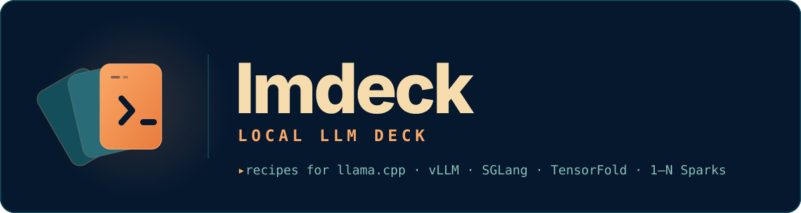

**lmdeck** is a single-binary CLI for running local LLMs from *recipes*. A recipe
says which model to use, which quant, which engine, and what hardware it
needs. lmdeck shows what's downloaded and what's loaded, starts and stops
servers, searches recipe repos on GitHub and Hugging Face, and checks whether
a recipe fits the machine you're on.

Supported engines: **llama.cpp** (`llama-server`), **vLLM** (native or Docker),
**SGLang** (native or Docker), **LMDeploy** (native or Docker), **TabbyAPI /
exllamav3** (EXL3), **LM Studio** (`lms`), **MLX** (`mlx_lm.server`), **TensorFold**
(`tensorfold serve`, Metal + CUDA), plus `custom` for anything with an
OpenAI-compatible `/v1/models`.

`custom` can also *wrap* a repo that already ships its own `start.sh` / `stop.sh`
(see [Wrapped recipes](#wrapped-recipes)). lmdeck clones it, runs its scripts and
watches the server. It never patches or builds an engine itself.

Recipes are TOML only.

## Install

Prebuilt binaries for Linux and macOS (arm64 and x86_64), no Rust toolchain:

```sh
curl --proto '=https' --tlsv1.2 -fsSL https://github.com/javierbits/lmdeck/releases/latest/download/install.sh | sh
# or, without curl:
wget -qO- https://github.com/javierbits/lmdeck/releases/latest/download/install.sh | sh
```

The installer verifies the release checksum and puts `lmdeck` in
`~/.local/bin`. `--version X.Y.Z` and `--dir /some/bin` override the release and
the directory. The Linux builds need glibc 2.35 or newer; on Alpine/musl use
the cargo install below.

From crates.io (Rust 1.85 or newer):

```sh
cargo install lmdeck
cargo binstall lmdeck        # prebuilt release binary instead of a compile
```

`cargo binstall` needs [cargo-binstall](https://github.com/cargo-bins/cargo-binstall)
installed first.

Homebrew (macOS or Linux):

```sh
brew install javierbits/lmdeck/lmdeck
```

Straight from the repository, latest `main`:

```sh
cargo install --git https://github.com/javierbits/lmdeck
```

lmdeck runs on Linux and macOS, on both arm64 and x86_64. Windows isn't
supported.

## Quick start

```sh
lmdeck doctor                 # hardware, engines, and which recipes fit
lmdeck engine install llama.cpp   # managed llama-server in lmdeck's cache
lmdeck browse                 # the recipe index
lmdeck add <name>             # install an index entry into your deck
lmdeck source add github:someone/recipes   # optional: more recipes
lmdeck recipe search --compatible
lmdeck recipe add ./my-recipe.toml         # or a file, URL, or source ref
lmdeck pull <name>            # hf download …
lmdeck use 1                  # start deck entry #1, wait until /v1/models answers 2xx
lmdeck list                   # ● loaded  ● external (not started by lmdeck)  ○ stopped  ✓ downloaded
lmdeck switch <name>          # stop the others, start this one
lmdeck stop --all
```

A server started outside lmdeck that answers with a recipe's model on its port
is **external**: lmdeck shows it as up and its `stop` runs the recipe's stop
command, but lmdeck didn't start it. **port taken** means another server holds
the port and is not that recipe. Each recipe is counted once as up, so a
copy shadowed by a deck recipe isn't a second server.

Run `lmdeck` with no arguments in a terminal to open the [TUI](#tui). When
stdout isn't a terminal, or with `--plain`, you get the wordmark and the deck
table instead, and can type a row number to toggle that recipe on or off.


## First run

The first time an interactive lmdeck command starts (`lmdeck`, `tui`, `serve`,
`use`, `switch`, `list`, `init`), a short setup runs before anything else:

1. **This machine**: what was detected: platform, CPU, memory, GPUs, engines,
   and the ConnectX-7 / RDMA ports, then a
   "does this look right?" confirm.
2. **Model weights**: the models dir, shown with the free space on that
   filesystem. The wizard starts with the Hugging Face cache (`$HF_HUB_CACHE`,
   else `$HF_HOME/hub`, else `~/.cache/huggingface/hub`), where `lmdeck pull`
   downloads (GGUFs too). It holds local-only weights and recipes with a
   `[model] path`; type `~/models` if you want those kept apart. Any time:
   `lmdeck init --models-dir /mnt/nvme/models`, `LMDECK_MODELS_DIR`, or the
   `models_dir` key in config.toml.
3. **The cluster**: the wizard looks for the other Sparks over the
   ConnectX-7 links only: the neighbours on each CX7 port (a sweep of the
   subnet when the neighbour table is silent) and the subnets routed through
   those ports, which is how a ring reaches the Spark across from it. Each
   address that answers on ssh or on `lmdeck serve` (port 7979) is grouped
   into one machine by its SSH host key, so two cables to the same Spark are
   one host, and named by its real hostname (read over ssh, or reported by
   `lmdeck serve`). With no hostname it asks; it never makes one up.

   The other machines must run `lmdeck serve`; without it they can't be
   driven or measured (see [docs/MULTIHOST.md](docs/MULTIHOST.md)). For each
   one that doesn't answer on 7979, the wizard offers to set it up over SSH
   on the CX7 address:
   - log in with keys only (`BatchMode`, which can't type a passphrase): when
     ssh's own choice is refused it tries each of your keys without a
     passphrase and keeps the one that works. If none is accepted it offers
     `ssh-copy-id -i` for the first one (your SSH password, typed into ssh
     itself), and makes a key first if you have none;
   - copy this lmdeck binary when the OS and CPU match, otherwise
     `cargo install --git https://github.com/javierbits/lmdeck` there;
   - write a new token to `~/.config/lmdeck/serve.env` there (mode 600, sent
     over stdin, never on a command line) and save it in `hosts.toml` here;
   - start `lmdeck serve --host <its CX7 address>`, as a systemd user service
     when you say so (`lmdeck-serve.service`, restarts on failure). To start
     it at boot it turns on `loginctl enable-linger`; if that needs sudo it
     asks for the password once, hidden, and passes it to `sudo -S` on stdin.
     It isn't saved or logged.
   - then checks that it answers, and adds the host under its hostname.


4. **Recipe sources**: repos that hold lmdeck recipe files (`.toml`), searched
   alongside your deck (`github:owner/repo`, `hf:owner/repo`, a URL, a local
   directory). There is no default source. A model repo with its own start
   scripts isn't a source: run `lmdeck add <url>` for it instead.

5. **Starter recipes**: nine recipes are compiled into lmdeck: LFM3 1.7B,
   LFM3 Omni 2B, Javi0.4 4B, Gemma 4 12B, Qwen3.6 27B, Qwen3.6 35B-A3B,
   Qwen3.8 Flash Next, DeepSeek V4.1 Flash 2x Spark and GLM-5.3 Flash 2x
   Spark. The wizard lists each one's size, engine and capabilities, then
   imports the ones you pick into your deck. Nothing is downloaded at import
   time: `lmdeck pull <name>` fetches weights for recipes lmdeck manages, and
   wrapped recipes' scripts fetch theirs on first start. Decline the menu and
   add one later with `lmdeck recipe add builtin/<name>`.

6. **Usage statistics**: whether lmdeck should record local token counts for
   the Stats tab (default off). It is the last question; see
   [Usage statistics](#usage-statistics).


Answers are saved to `~/.config/lmdeck/` (`hosts.toml`, `config.toml`) and
`[setup] done = true` keeps the wizard from asking again; `lmdeck setup` runs
it again (hosts and sources already there are kept). `LMDECK_NO_SYNC=1`

skips all first-run prompts; `lmdeck host add` and `lmdeck source add` do the
same jobs any time.

## TUI

`lmdeck` (or `lmdeck tui`) opens a full-screen dashboard. Its look borrows from
[oh-my-pi](https://github.com/can1357/oh-my-pi): powerline segments, status
pills, rounded panels, and a status bar with key hints.
- **Deck**: your recipes with status pills (running, loading, stopped, pulling),
  download state (✓ on disk, ↓ pulling, · not yet) and fit (✓ fits, ! tight,
  ✗ no fit). The list groups models by family under `── Qwen ──`-style
  separators (`F` toggles it; the web dashboard has a Group families button).
  Running recipes show their live tok/s in the list next to the size. Next to
  the list are a details pane with the checks and the exact
  launch command, and the live log of the selected recipe. A running recipe
  also shows its process RSS and share of RAM, VRAM on discrete GPUs, tok/s
  when the engine exposes metrics, and GPU / power / temperature sparklines.
- **Hosts**: live telemetry for this machine and every host in `hosts.toml`
  (see [Hosts and telemetry](#hosts-and-telemetry)): memory, temperature,
  power, GPU and CPU use and tok/s as bars with ▲/▼ change over the last
  minute, heat-coloured history columns, gauges and a few minutes of history
  for the selected host, and a detail strip with where each number came from.
  Offline hosts are greyed out with the error and when they were last seen.
  `←→` picks a model running on that host; `x` stops it, `l` shows its log,
  and `↵` / `s` start or switch the Deck tab's selected recipe **on that
  host** (see [docs/MULTIHOST.md](docs/MULTIHOST.md)).
- **Topology**: hosts with dot-art device icons, GPUs, cables and synthetic switches from the L2 graph
  (auto-detected, or `[[link]]` in hosts.toml), LAN / Tailscale fallbacks,
  the management links from this machine, and which links are busy carrying
  NFS weights or a multi-node run.
- **Machine**: platform, CPU and memory gauges, the memory held by running
  recipes, per-GPU memory, and which engines and tools are installed.
- **Sources**: the deck and every recipe source, with recipe counts and when
  each source was last fetched.
- **Stats**: local usage recorded from the engines' metrics (opt-in, see
  [Usage statistics](#usage-statistics)): a GitHub-style activity calendar,
  all-time and per-model token totals, the selected day's models, and that
  day's hour-by-hour token profile. On a controller it merges every watched
  host's own usage (per-host totals in the All time panel). `←→` walks days,
  `↑↓` weeks, `G` jumps to today.

The screen refreshes every 2 s in the background. Starting, stopping and
pulling run off the UI thread, so nothing freezes while a server loads.
Quitting leaves servers running.

| key | action |
|---|---|
| `↑ ↓` / `j k`, `PgUp PgDn`, `g G` | move |
| `↵` / `space` | start or stop the selected recipe |
| `s` | switch: stop the others, start this one |
| `o` | run on another host: a picker with, per host, where the weights come from (here / read-only NFS over CX7), the link, a load-time estimate and the fit on that host |
| `x` | stop |
| `p` | pull the weights, or update a wrapped recipe's checkout (runs in the background; the log pane shows progress) |
| `u` | take a `⬆` upstream update; for a pinned wrapped recipe this also moves the pin (`pull --latest`) |
| `l` | expand the log pane (`j k` then scroll it) |
| mouse wheel | scroll the live log on the deck; on other tabs it moves the list |
| `/` | fuzzy search (`↵` keeps the filter, `esc` clears it) |
| `f` | only recipes that fit this machine |
| `a` | deck ↔ every known recipe |
| `1`–`6`, `tab` | deck · hosts · topology · machine · sources · stats (on Hosts, `↑ ↓` picks a host, `← →` a model on it, `↵`/`s`/`x`/`l` act there; on Stats, `← →` picks a day, `↑ ↓` a week, `G` today) |
| `t` | next theme (saved to config) |
| `T` | theme picker: `↑ ↓` previews live, `↵` saves, `esc` reverts |
| `r` | refresh now (re-probes engines) |
| `F` | group the deck by model family (`── Qwen ──` sections; `Qwen`, `GLM`, `DeepSeek`, …) — on again to flatten |
| `q`, `esc`, `ctrl-c` | quit |

If your terminal font is a Nerd Font, `--nerd` (or `LMDECK_NERD_FONT=1`)
draws rounded powerline caps on the pills. Themes are covered [below](#themes).

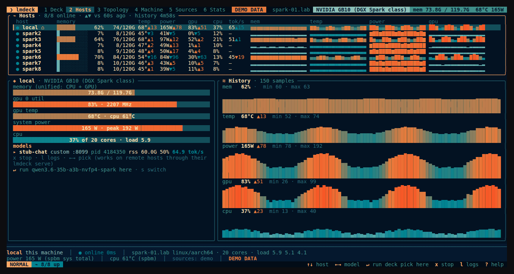

| | |
|---|---|
|  | |
|  | 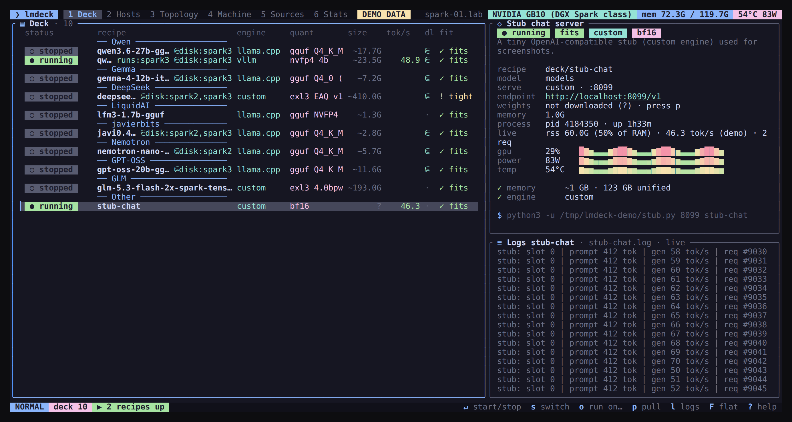 |

## Themes

lmdeck has 24 themes: Retro 82 is the default; its own `omp` (the oh-my-pi
palette) and every theme that ships with
[Omarchy](https://omarchy.org/): Catppuccin, Catppuccin Latte, Ethereal,
Everforest, Flexoki Light, Gruvbox, Hackerman,
Kanagawa, Last Horizon, Lumon, Lupine, Matte Black, Miasma, Nord, Osaka Jade,
Retro 82, Ristretto, Rosé Pine, Solitude, Starship, Tokyo Night, Vantablack
and White. The TUI and the web dashboard use the same theme.

```sh
lmdeck theme list               # every theme with swatches; ● marks the current one
lmdeck theme set rose-pine      # saved as `theme = "rose-pine"` in config.toml
lmdeck theme show [name]        # its colours, by role, and where they come from
lmdeck theme sync-omarchy       # use the theme Omarchy is currently on
lmdeck theme reset              # back to the default (Retro 82)
```

Theme names are forgiving: `"Rosé Pine"`, `rose-pine`, `ROSE PINE` and `rose`
all mean the same theme. In the TUI, `t` cycles through the themes and `T`
opens a picker with swatches and a live preview. Both save your choice. In the
browser, the swatch menu in the top bar applies a theme straight away and saves
it to the same config file. If saving fails, for example on a read-only config,
the choice is kept in that browser only. `?theme=nord` in the URL previews a
theme without saving it. To use a theme for one run only, pass
`lmdeck tui --theme nord` or set `LMDECK_THEME=nord`. Either one takes
priority over the saved theme.


| | |
|---|---|
| 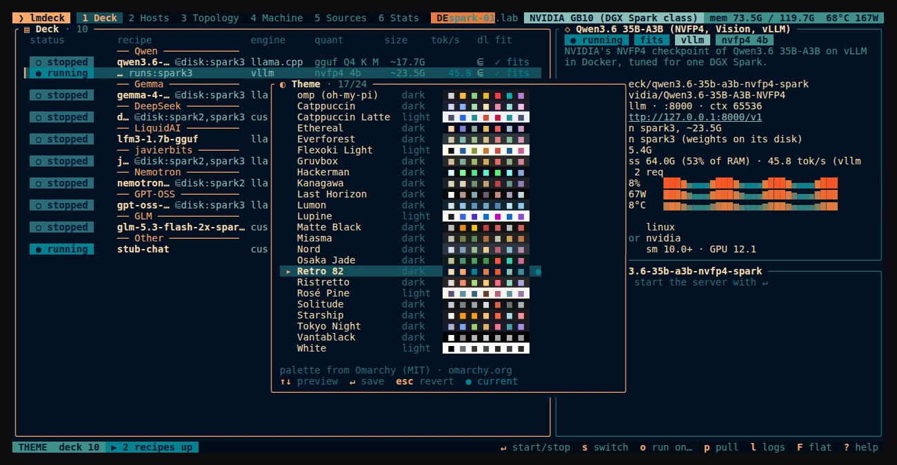 | 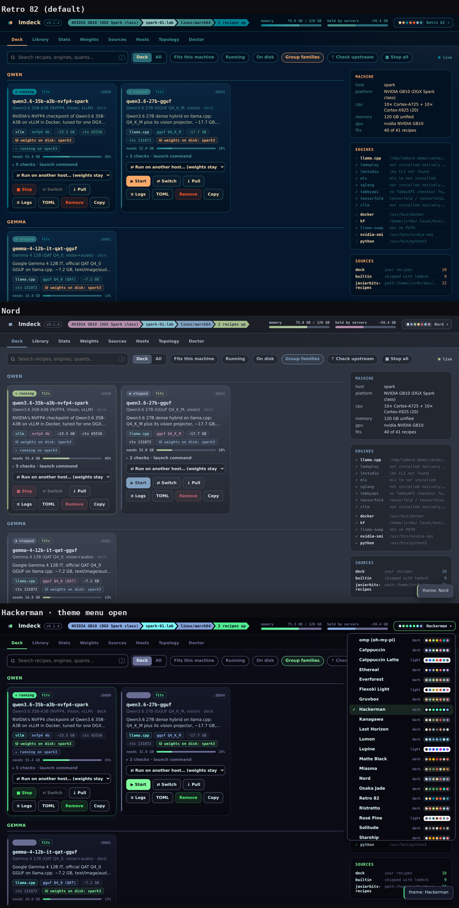 |

The colours are Omarchy's, copied verbatim from
[`themes/<name>/colors.toml`](https://github.com/omacom/omarchy/tree/967bbdd7346e6e2ff1a6af33c5d762ea784832cc/themes)
at commit `967bbdd` (the repo is now `omacom/omarchy`, formerly
`basecamp/omarchy`; MIT, © David Heinemeier Hansson; see [licenses/omarchy-MIT.txt](licenses/omarchy-MIT.txt)).
Each of lmdeck's roles (text, accent, ok, warning, error, borders, selection,
pills) takes the first colour in the theme's own palette that meets a contrast
threshold against the background: 4.5:1 for text and 3:1 for status colours.
This keeps light themes readable. No colour is invented (the web page only
adds translucent tints and gradient ends mixed from these colours), and the
tests check both rules for every theme. Monochrome themes such as White and
Vantablack therefore show status in greys, just like the originals. To
regenerate the table after Omarchy adds or changes a theme:

```sh
git clone https://github.com/omacom/omarchy /tmp/omarchy
python3 scripts/import-omarchy-themes.py /tmp/omarchy > src/theme/omarchy.rs
```

## Harness sync

When a recipe starts, lmdeck can also point your agent CLIs at it, the way
lmswitch does: every running server becomes a provider entry (or a
custom-provider lane) in the config of each harness you chose, with its own
`http://<host>:<port>/v1` base URL, display name and context window. When the
server stops, its entry goes away. Your own entries in those files are never
touched.

Supported harnesses: **OpenCode** (`~/.config/opencode/opencode.json`),
**omp** (`~/.omp/agent/models.yml`), **Grok** (`~/.grok/config.toml`),
**pi** (`~/.pi/agent/models.json`) and **Hermes** (`~/.hermes/config.yaml`).

The first time you run lmdeck in a terminal it asks which ones to sync with
(detected ones default to yes) and which hosts' running models to include;
the answers are saved to `[harness]` in config.toml. Change them later with
`lmdeck harness enable|disable <name>` and `lmdeck harness hosts all|none|NAME…`,
run a sync right now with `lmdeck harness sync`, or list what is detected with
`lmdeck harness`. `LMDECK_NO_SYNC=1` turns the whole thing off, and
`LMDECK_SYNC_HOST=<host>` overrides the host used in the written URLs (by
default the config `host` when it is a specific address, else
`<hostname>.local`, so the URLs also resolve from other machines on the LAN).

Models running on your other machines are included too: every configured host
(hosts.toml) is asked what it is serving, and its running models become lanes
in the same configs, pointed at that host's address — spark2's models show up
in sparkA's opencode without touching spark2. Each lane gets its own base
URL; remote lanes are tagged with the host (`glm5.3-flash [Spark2]` in grok).
An offline host just contributes nothing.

With several machines, make one of them the **hub**: the one whose hosts.toml
lists every other host (`lmdeck harness hub on`, saved as `[harness] hub =
true`). After every start or stop it performs (the CLI, `--on`, the TUI, the
dashboard, `lmdeck harness sync`), the hub pushes the list of every model
running anywhere to every host in hosts.toml, and its `lmdeck serve` looks
for models started or stopped elsewhere every `LMDECK_HARNESS_SYNC_SECS`
seconds (default 15, `0` turns the looking off). The other machines need no
host list: their serve stores the last push and syncs with it plus their own
running models, and their own syncs keep the pushed ones. Without a hub,
`lmdeck use X --on <host>` and `lmdeck stop X --on <host>` sync the machine
that ran them. Addresses, auth and what it costs:
[docs/MULTIHOST.md](docs/MULTIHOST.md#harness-sync-from-one-hub).

A multi-node (`[[nodes]]`) recipe is one lane named after the recipe, the
model its head serves (`--served-model-name <recipe>`, `--alias <recipe>`),
with the head's address and port, wherever the head runs. Its workers serve
no API and get no lane.

A recipe that isn't a chat model (a decision or classifier server that
answers its own API) opts out, here and in other hosts' syncs:

```toml
[harness]
chat = false   # default true
```

There is also an opt-in mirror: `lmdeck harness export on` writes the same
`opencode.json` payload to `~/.local/share/opencode-export/` — the copy a
second machine's pull job can fetch over HTTP (lmdeck serves nothing for
this itself). Off by default; `lmdeck harness` shows its state.

## Web dashboard

```sh
lmdeck serve                    # http://127.0.0.1:7979/
lmdeck serve --port 8800
lmdeck serve --host 0.0.0.0 --token "$(openssl rand -hex 16)"   # see the warning below
```

`lmdeck serve` runs the same controls in a browser, in tabs:

- **Deck**: a card for each recipe with status, fit, size, a memory bar,
  checks and the launch command; Start / Stop / Switch / Pull buttons (Start
  and Switch run a recipe on the host that holds its weights when this machine
  doesn't, as `lmdeck use` does; wrapped recipes with new upstream commits get
  a `⬆ update` badge and an `⬆ Update` button); search and filters (fits,
  running, on disk); a TOML viewer and a remove button; a live log drawer;
  and **Check upstream** (`lmdeck outdated`) / **Stop all** (`lmdeck stop
  --all`) buttons.
- **Library**: the recipe index (`lmdeck browse`) with search, tag filters,
  fits/speed sorting, one-click install (the same path as `lmdeck add`), and
  forms for `lmdeck add <repo>` and `lmdeck recipe add <ref>`.
- **Stats**: token usage recorded from engine counters (opt-in via
  `[stats] record = true`, see [Usage statistics](#usage-statistics)) as an
  activity calendar, per-model totals and the selected fleet's hourly profile.
- **Weights**: which host holds which checkpoint (`lmdeck weights`).
- **Sources**: add, re-fetch and remove recipe sources (`lmdeck source …`).
- **Hosts**: one card per host (memory, temperature, power, tok/s, sparklines,
  the running models) that updates every 2.5 s, plus add/forget and
  `lmdeck host sync`.
- **Topology**: the hosts and their CX7 / LAN / Tailscale links.
- **Doctor**: hardware, engines and tools, recipe parse errors, the managed
  llama.cpp install (`lmdeck engine install llama.cpp`), and the agent-harness
  mirror (`lmdeck harness …`).

The page and its JSON API are compiled into the binary, so nothing is fetched
from a CDN.

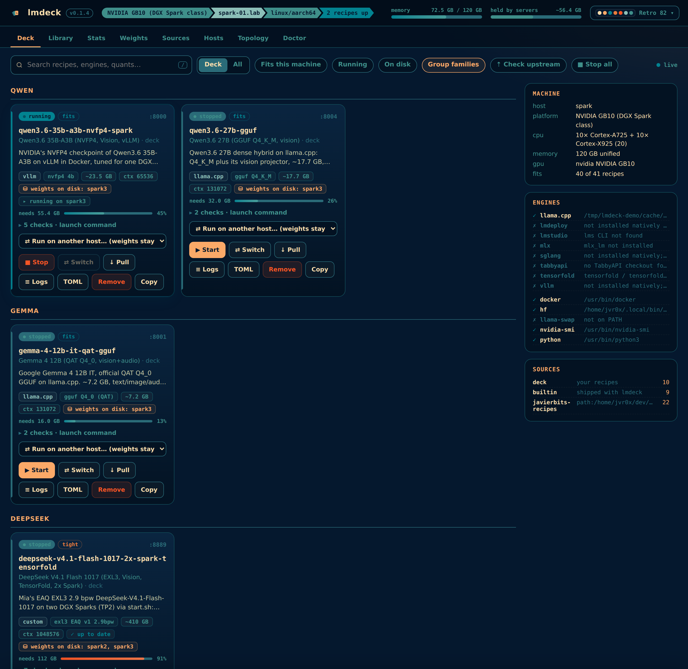

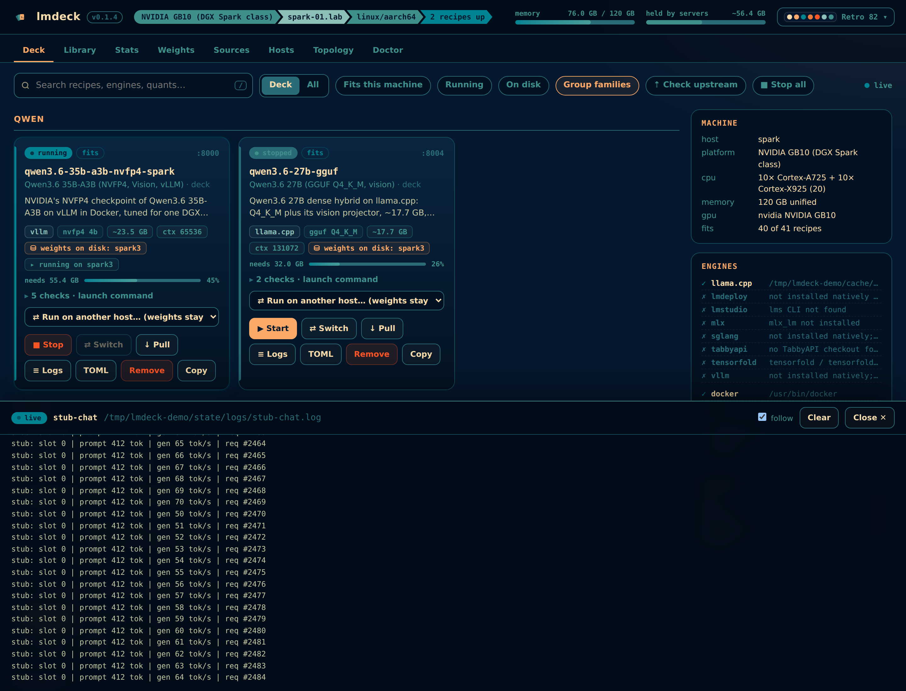

| | |
|---|---|
| 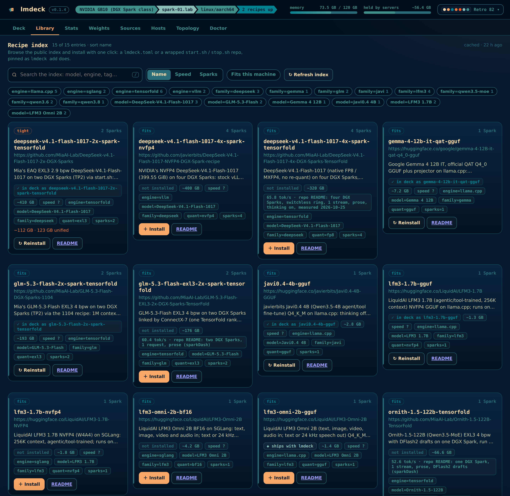 | 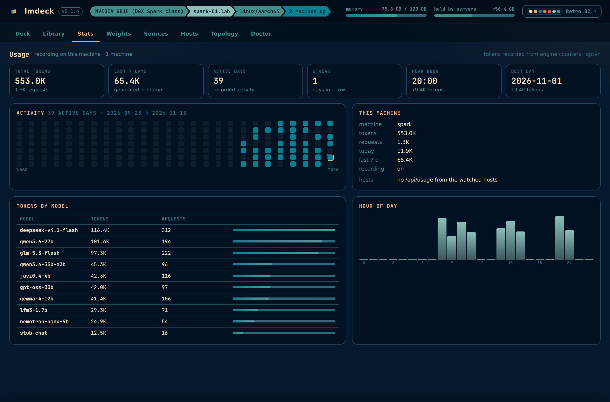 |
| 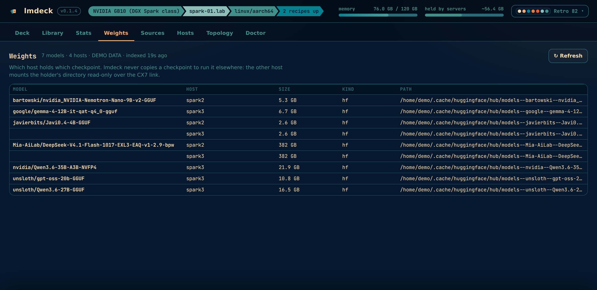 | 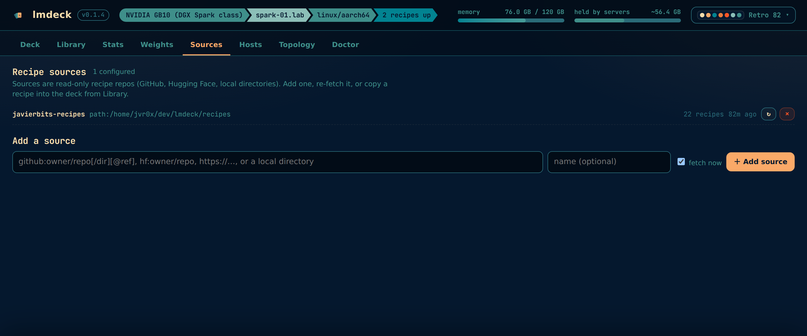 |
| 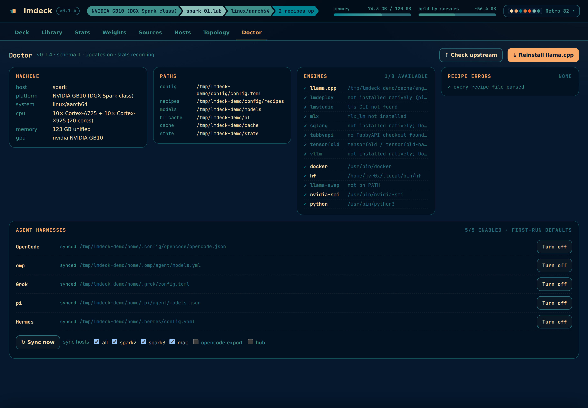 | |

Across machines (details in [docs/MULTIHOST.md](docs/MULTIHOST.md)): host cards
have `≡` logs and `■` stop per model and a **run here** picker; recipe cards
show **⛁ weights on disk: …**, `×N nodes` with the start order for multi-node
recipes, and a **Run on another host…** dropdown that opens the plan (NFS
steps, link, load estimate, fit) before anything starts; a **Topology**
section draws the hosts and their CX7 / LAN / Tailscale links as an SVG.

| | |
|---|---|
| 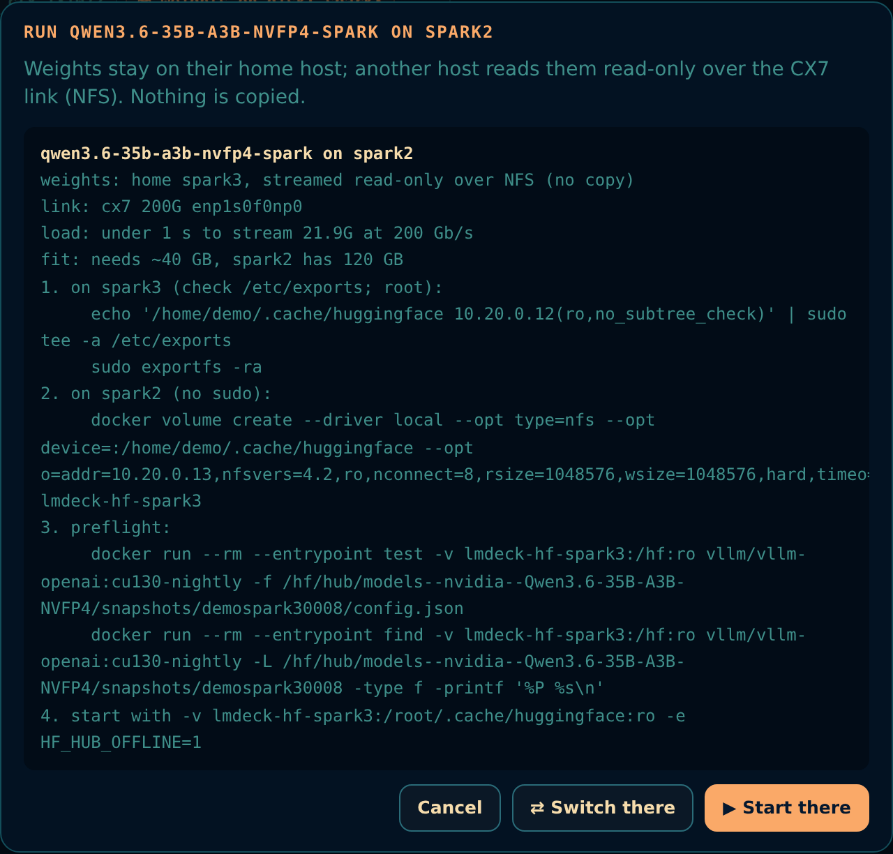 | 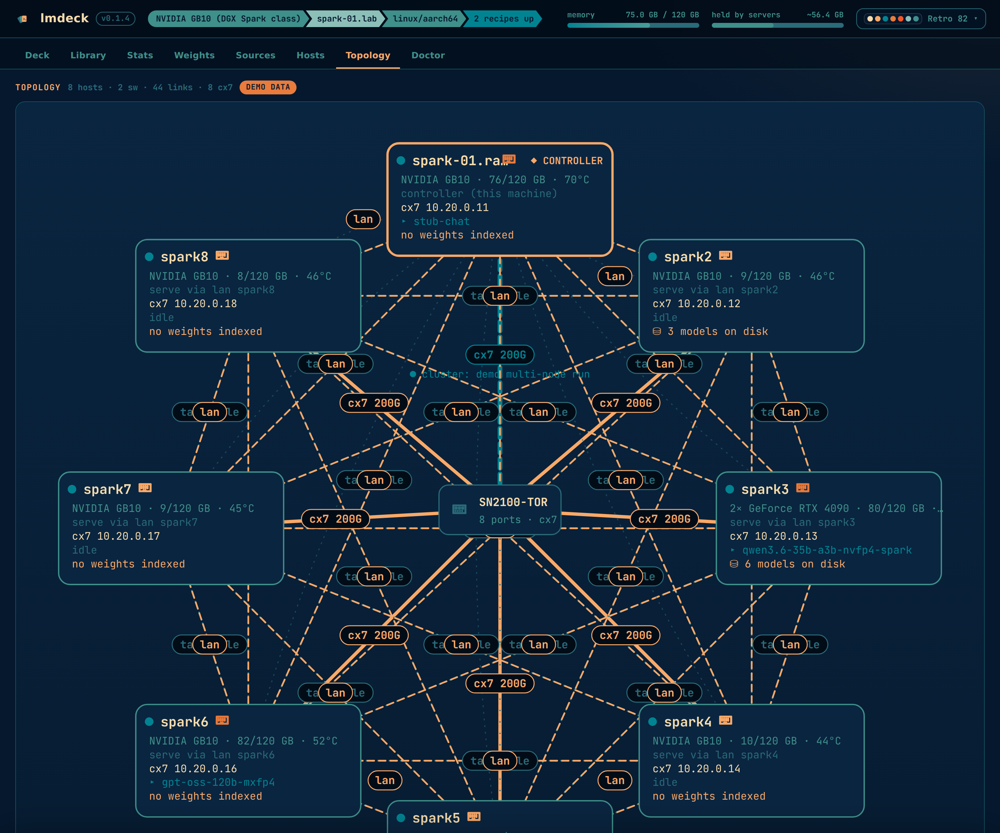 |
| 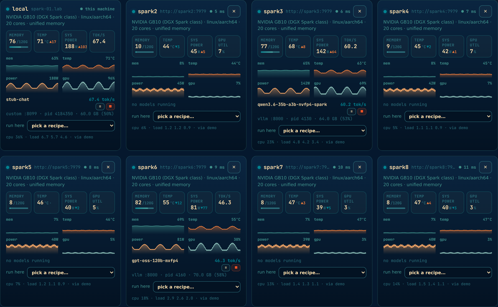 |  |

> [!WARNING]
> **Binding to anything other than localhost (for example `--host 0.0.0.0`)
> lets anyone who can reach that port start and stop servers and download
> models on this machine.** lmdeck refuses to do that without a token: if
> you don't pass `--token` (or set `LMDECK_TOKEN`), it generates one and
> prints the URL with it. There's no TLS, so on an untrusted network put it
> behind a reverse proxy with HTTPS, or use an SSH tunnel
> (`ssh -L 7979:127.0.0.1:7979 host`) and keep the default bind.

API (JSON unless noted):

| method | path | what it does |
|---|---|---|
| `GET` | `/api/health` | `{ok, version}`; never needs the token |
| `GET` | `/api/snapshot` | everything below in one document |
| `GET` | `/api/recipes` | every recipe, with status, download state, size, fit, checks and the launch command |
| `GET` | `/api/status` | running and deck recipes: status, port, endpoint |
| `GET` | `/api/doctor` | hardware, installed engines and tools, recipe parse errors, paths, update-check and stats settings |
| `GET` | `/api/sources` | the deck and sources with recipe counts |
| `GET` | `/api/browse?q=&tag=&sort=&fits=1&refresh=1&offline=1` | the recipe index joined with this machine (`lmdeck browse --json`), plus the tag list for filters |
| `GET` | `/api/outdated?fetch=1` | every wrapped recipe's upstream state, refreshing the cache first (`lmdeck outdated`) |
| `GET` | `/api/recipe/{reference}` | one recipe's file and full TOML (`lmdeck recipe show --toml`) |
| `GET` | `/api/harness` | the harness mirror's state: enabled/installed harnesses, config paths, hosts, export and hub settings |
| `GET` | `/api/weights/index?refresh=1` | every host's weights inventory and where each model is (`lmdeck weights`) |
| `GET` | `/api/telemetry?history=1&since=MS` | this machine's live telemetry (memory, GPUs, temperatures, power, load, running models with RSS and tok/s); with `history=1` also the samples newer than `since` (ms since the epoch) |
| `GET` | `/api/usage` | this machine's usage statistics (`[stats] record`): days, per-model totals, hourly buckets; the Stats tab's fleet view reads it from each host |
| `GET` | `/api/hosts` | `{at, demo, hosts:[…]}`: this machine plus every host in `hosts.toml`, each with `online`, `error`, `latency_ms`, `last_seen`, `telemetry`, `history` and (when it answers `/api/usage`) `usage` |
| `GET` | `/api/logs/{recipe}?n=200` | the tail of the server (or pull) log |
| `GET` | `/api/logs/{recipe}/stream` | Server-Sent Events: a `reset` event, then one `data:` line per log line |
| `POST` | `/api/start/{recipe}` · `/api/switch/{recipe}` · `/api/stop/{recipe}` · `/api/pull/{recipe}` | runs the action and returns `{ok, message}`; a refused action is `409` with `{ok:false, error}`. Optional body `{"force": true}` skips the fit checks; `{"latest": true}` on `pull` moves a pinned wrapped recipe to the upstream head (`pull --latest`). On `start` / `switch`, `{"on": "<host>"}` runs it on that host, and `{"auto": true}` runs it where its weights are, as `lmdeck use` without `--on` does (the dashboard's Start and Switch send it); without either it runs on this machine, which is how a controller starts a recipe on the host it picked. |
| `POST` | `/api/add` | `{"repo": "<index name, owner/repo, URL or directory>", "name": …, "ref": …, "force": …}` installs like `lmdeck add` and returns the progress lines |
| `POST` | `/api/recipe/add` · `/api/recipe/remove/{name}` | copy a recipe into the deck (`lmdeck recipe add`), or remove a deck recipe by name (`lmdeck recipe remove`) |
| `POST` | `/api/source/add` · `/api/source/update` · `/api/source/remove/{name}` | `{"spec": …, "name": …, "fetch": true}` adds a source; `{"name": …}` (or nothing) re-fetches; remove forgets it and its cache |
| `POST` | `/api/host/add` · `/api/host/sync` · `/api/host/remove/{name}` | `{"name","url","token","token_env","link_addr","check"}` adds a host; `{"dry_run": …}` runs `lmdeck host sync`; remove forgets one |
| `POST` | `/api/harness/{enable,disable,sync,hosts,export,hub}` | the harness mirror: `{"name"}`, `{}`, `{"hosts": null or […]}` (`null` = all configured, `[]` = local only), `{"on": …}` |
| `POST` | `/api/stop-all` | stops every server lmdeck started on this machine (`lmdeck stop --all`) |
| `POST` | `/api/engine/install/{engine}` | installs a managed engine (currently `llama.cpp`); `{"force": true}` reinstalls |

`{recipe}` is a name or an `origin/name` reference; a `remove` path takes the
deck recipe name (the file stem). Management routes (`add`, `recipe/*`,
`source/*`, `host/*`, `harness/*`) write the deck or config and reload the
running server, so the catalog reflects them immediately. Start and switch
return as soon as the server process is launched; poll `/api/status` to see it
come up.

Guards:

- `POST` requests need an `X-Lmdeck: 1` header. A cross-site form or ``
  can't add one.
- When bound to loopback, the `Host` header must be `localhost`, `127.0.0.1`
  or `[::1]`. That blocks DNS-rebinding pages.
- With a token, every `/api` route except `/api/health` needs
  `Authorization: Bearer <token>` or `?token=<token>` (for EventSource). The
  dashboard reads the token from the `#token=` part of the URL it prints and
  keeps it in the browser's local storage.

```sh
curl -s localhost:7979/api/status
curl -s -X POST -H 'X-Lmdeck: 1' localhost:7979/api/switch/qwen3-4b-gguf
curl -N localhost:7979/api/logs/qwen3-4b-gguf/stream
```

The screenshots use `LMDECK_DEMO=1` (synthetic telemetry and hosts) and a demo
deck with recipes from several labs; see [Demo mode](#demo-mode).

## Hosts and telemetry

Every `lmdeck serve` samples its own machine every 2 s and keeps about six
minutes of history in memory. Add the other machines to watch and the local
TUI and dashboard show them next to this one:

```sh
# on each DGX Spark / Mac: listen on the Tailscale (or LAN) address with a token
lmdeck serve --host 100.101.102.103 --token "$(openssl rand -hex 16)"

# on the machine you look from
lmdeck host add spark1 http://spark1:7979 --token <that token>
lmdeck host add spark2 http://spark2:7979 --token <…>
lmdeck host add mac    http://mac-studio:7979 --token <…>
lmdeck host list          # polls each one: ● online 4 ms / ○ offline · timed out
lmdeck host remove mac
lmdeck host sync          # every host's hosts.toml lists the whole cluster (over ssh; safe to rerun)
```

Design:

- **Pull.** The local instance polls each host's
  `GET /api/telemetry?history=1&since=…` in parallel, every 2 s, with a
  1.5 s timeout. The first poll fetches the remote history, after that only
  the new samples.
- **Remote control.** Start, stop, switch and logs on another host go to
  that host's own `lmdeck serve`: `lmdeck use|switch|stop|logs … --on spark2`,
  the TUI Hosts tab, or the dashboard's host cards. A host only runs recipes
  it has by name unless it sets `[serve] accept_recipes = true`. A recipe
  that uses peer placeholders (`{peer_addr}`, …) always goes uploaded, with
  the peers the controller picked filled in.
- **Multi-host** (weights on another host, a start without `--on` going to
  the host that holds them, running a model where its weights aren't,
  `[[nodes]]` recipes across Sparks, CX7 detection, topology): see
  **[docs/MULTIHOST.md](docs/MULTIHOST.md)**. A `[[nodes]]` worker with
  `host = "auto"` gets its machine from the head's CX7 fabric (on a ring,
  the head's cable neighbours first), so a recipe needn't name your hosts.
  A node gets the weights' NFS volume only when its command mounts them
  (`{weights_mount}` / `{weights_volume}`), so `[model]` costs nothing on a
  node such as llama.cpp's `rpc-server`.
- **`hosts.toml`** lives in the config dir (`~/.config/lmdeck/hosts.toml`):
  `[[host]] name / url / token` (or `token_env = "VAR"`, or
  `LMDECK_HOST_TOKEN_<NAME>` in the environment), optional `link_addr`, and
  `[[link]]` overrides. lmdeck writes it with mode `0600` because
  it holds tokens. It's re-read every round, so edits apply without a
  restart. Keep it out of git.
- **Tokens** go out as `Authorization: Bearer <token>`, per host. A wrong
  token shows as `unauthorized: wrong or missing token`. There's no TLS
  beyond what the URL gives you, so use Tailscale, a VPN, or an HTTPS
  reverse proxy, never a public port.
- **Offline hosts** stay listed, greyed out, with the error (`connection
  refused`, `timed out`, an HTTP status) and their last numbers and when they
  were last seen.

What gets measured, and where it comes from:

| what | Linux / DGX Spark (GB10) | NVIDIA discrete GPUs | macOS (no sudo) |
|---|---|---|---|
| memory | `/proc/meminfo` (`MemTotal − MemAvailable`). On GB10 this is the unified CPU+GPU pool. | same, plus VRAM from `nvidia-smi` | `vm_stat` + `sysctl hw.memsize`, `kern.memorystatus_level` as pressure |
| GPU temp, power, util, SM clock | `nvidia-smi --query-gpu`. GB10 reports `[N/A]` for memory and the power limit; those become blanks, not zeros. | `nvidia-smi` | not available without sudo; `LMDECK_POWERMETRICS=1` tries `sudo -n powermetrics` (off by default) |
| CPU temp | hwmon: `spbm` (the [spark_hwmon](https://github.com/antheas/spark_hwmon) driver) if loaded, else `k10temp` / `coretemp` / ACPI thermal zones | same | – |
| system power | `spbm` `sys_total` / `dc_input` if loaded; otherwise the GPU's draw. NVIDIA doesn't expose CPU power on GB10. | GPU draw | powermetrics (opt-in) |
| CPU use, load | `/proc/stat`, `/proc/loadavg` | same | `sysctl vm.loadavg` |
| per model | PID from the run record, RSS of its process tree (`ps`), its share of RAM, VRAM from `nvidia-smi --query-compute-apps` | same | RSS and share |
| tok/s | the engine's Prometheus `/metrics`: vLLM `vllm:generation_tokens_total`, SGLang `sglang:generation_tokens_total`, llama.cpp `llamacpp:tokens_predicted_total` (lmdeck adds `--metrics` to llama-server), TensorFold `tensorfold:generation_tokens_total` and `generation_tokens_running` (wrapped `custom` recipes are scraped when they expose it). A rate between two samples; otherwise "n/a". | same | same (MLX / LM Studio have no metrics, so n/a) |

Anything a machine doesn't report is shown as `–`, never guessed. Docker
recipes show tok/s (the metrics port is published) but no RSS, because the
container isn't in lmdeck's process tree.

### Demo mode

`LMDECK_DEMO=1` swaps every reading for **synthetic** numbers: a busy local
"spark1", spark2 (busy), spark3 (idle) and an offline Mac. It exists for
screenshots and UI work. The TUI header, the Hosts strip, `lmdeck host list`,
the dashboard and every JSON document (`"demo": true`) say **DEMO DATA**
while it's on. The screenshots use demo mode with a demo deck spanning
DeepSeek, GLM, LiquidAI, Qwen, javierbits, NVIDIA Nemotron, Gemma and GPT-OSS,
plus a small `custom` stub server whose log lines are synthetic. The fit
column and Machine panel describe the Spark-class machine they were captured
on.


## Commands

| command | what it does |
|---|---|
| `lmdeck list [-a] [-l] [-d] [--json] [--flat]` | Shows the deck with status (● loaded, ◐ loading, ● external, ○ port taken, ○ stopped), download state (✓/✗), size and port, grouped under `── Family ──` separators (Qwen, GLM, DeepSeek, …; `--flat` disables the grouping). `-a` lists every known recipe, `-l` only running servers, `-d` the weights on disk (models dir and HF cache; a cache repo holding GGUFs shows as `gguf`). |
| `lmdeck use <ref\|#> [--only] [--no-wait] [--force] [--dry-run]` | Starts a recipe. The aliases `on` and `start` do the same. Before launching it checks compatibility, the engine, free memory and the port. Then it waits until `GET /v1/models` answers 2xx: any other answer is a server still loading (llama-server says 503 until its model is in memory), and the status reads loading (◐) meanwhile. A server behind a key gets its own: an `--api-key` in the command, or TabbyAPI's `api_key` from `api_tokens.yml` in its checkout. `--dry-run` prints the exact command and runs nothing. With other hosts in `hosts.toml`, a recipe whose weights this machine lacks but another host holds runs on that host (its weights home), exactly as `--on <that host>` would; when this machine holds them too, or no host does, it runs here. The plan and the start output say where and why (`why: weights on ember, not here`, or `where: here (weights here)`); `--on local` runs it here anyway. See [docs/MULTIHOST.md](docs/MULTIHOST.md#3-choosing-where-a-model-runs---on). |
| `lmdeck switch <ref\|#>` | Same as `use --only`: stops every other lmdeck server first. |
| `lmdeck stop <ref\|#>` / `--all` | Stops a server. lmdeck sends SIGTERM to the process group and SIGKILL after 20 s. Docker recipes get `docker stop`, LM Studio gets `lms unload`, wrapped recipes run their `stop` script first. |
| `lmdeck pull <ref> [--latest] [--dry-run]` | Downloads the weights with `hf download` (or `huggingface-cli`) into the Hugging Face cache, passing `--revision` and `--include` as needed; a recipe with a `[model] path` (any engine: that is where it runs from) gets them there instead (`--local-dir`). `hf download` keeps a file's place in the repo, so a llama.cpp path (the GGUF itself) must end with its first `files` entry, e.g. `…/UD-IQ4_NL/X-00001-of-00005.gguf`. LM Studio recipes use `lms get` instead; TensorFold recipes use `tensorfold pull <repo>@<revision>`. For a recipe with a `[source]`, it fetches the checkout and checks out its `ref` again (and downloads nothing unless the recipe also has a `[model]` repo without `pull = false`). A recipe with `pull = false` is never downloaded: its own scripts fetch its weights. `--latest` first moves a pinned `ref` to the upstream head, rewriting the deck recipe. |
| `lmdeck outdated [names] [--fetch] [--json]` | Asks each cloned wrapped recipe's upstream (`git ls-remote`, no fetch) whether it has new commits, and prints local and remote commits and what to run. `--fetch` also fetches into the checkout so it can count the commits behind. Alias `updates`. See [Update checks](#update-checks). |
| `lmdeck browse [words] [-t TAG]… [--sort name\|sparks\|speed] [--fits] [--refresh\|--offline] [--json]` | Lists the [recipe index](#recipe-index) with installed state, update badge, fit and the speed each repo reports. Words match name, description and tags; `-t exl3` or `-t sparks=2` filters by tag. |
| `lmdeck add <name>` | Installs an index entry by name: its native recipe if it has one, otherwise the repo's own `lmdeck.toml`, otherwise it wraps the repo like `add <repo>`. A typo gets `did you mean: …`. |
| `lmdeck add <repo> [--name N] [--ref R] [--force]` | Adds a repo to the deck. If the repo has a `lmdeck.toml` at its root, that native recipe is installed; otherwise a repo with root `start.sh` and `stop.sh` is cloned, its scripts read, and a wrapper recipe written. `<repo>` is `owner/repo`, a GitHub or git URL, or a local directory. See [Wrapped recipes](#wrapped-recipes) and [A repo's own recipe](#a-repos-own-recipe). |
| `lmdeck logs <ref> [-n N] [--on HOST] [--node N]` | Prints the tail of the server log (of another host, or one node of a multi-node recipe). |
| `lmdeck use\|switch\|stop <ref> --on HOST [--allow-slow-link]` | Runs or stops it on another host. If the weights live elsewhere they are mounted read-only over NFS on the CX7 link, never copied; without a CX7 link this is refused unless `--allow-slow-link`. A wrapped recipe's peers (`[hardware] hosts`) are picked here, around that host (see "Recipe format"). `--dry-run` prints the plan. `--on local` (or this machine's `[node] name`) runs it here, the way `use` without `--on` did before it followed the weights: nothing is placed or mounted, and the engine or the recipe's scripts fetch the weights if they need them. A missing llama.cpp is offered as a managed install; `--yes` installs without asking, `--no-install` only fails with the command to run. Docker recipes offer `docker pull` when the image is not local. |
| `lmdeck weights [--refresh] [--json]` | Which host has which weights (each `serve` reports its own). |
| `lmdeck hosts topology [--json] [--no-verify]` | Hosts and the links between them: CX7 cables, LAN, Tailscale, with a ping / TCP check. |
| `lmdeck recipe search [words] [--engine E] [--quant Q] [--compatible] [--source S] [--json]` | Searches the deck and every source, with a fit column (✓ ok, ! warning, ✗ won't fit). |
| `lmdeck recipe add <ref\|file\|url> [--name N] [--force]` | Copies a recipe into your deck as TOML. |
| `lmdeck recipe list [--source S]` / `show <ref> [--toml]` / `run <ref>` / `remove <name>` | Lists, inspects, runs or removes recipes. `run` starts a recipe without adding it to the deck. |
| `lmdeck source add <spec> [--name N] [--no-fetch]` / `list` / `update [name]` / `remove <name>` | Manages recipe sources. |
| `lmdeck doctor [--json]` | Shows the platform (GB10, Apple Silicon, NVIDIA, CPU), memory, GPUs and compute capability, which engines are installed, paths, sources, and a per-recipe fit table. Missing engines get the exact install command. |
| `lmdeck engine install llama.cpp [--force]` | Downloads the pinned llama.cpp release for this platform into `~/.cache/lmdeck/engines/llama.cpp/`, verifies its SHA-256, and unpacks it beside its shared libraries. No sudo, no PATH change. |
| `lmdeck init [--models-dir DIR]` | Writes `~/.config/lmdeck/config.toml`. |
| `lmdeck tui [--theme T] [--nerd] [-a]` | Opens the full-screen TUI. A bare `lmdeck` does the same in a terminal; `--plain` turns that off. `--theme` overrides the saved theme for this run. |
| `lmdeck theme list` / `set <name>` / `show [name]` / `sync-omarchy` / `reset` | Lists, saves or inspects the colour theme used by the TUI and the web dashboard (see [Themes](#themes)). |
| `lmdeck host add <name> <url> [--token T] [--no-check]` / `list [--json]` / `remove <name>` / `sync [--dry-run]` | Manages the other machines to watch (see below). `add` checks the host answers unless `--no-check`; `list` polls every host once; `sync` pushes the full host list (with tokens, read over ssh when missing) to every host's hosts.toml, adding or updating only. `lmdeck setup` runs it too. |
| `lmdeck harness [list]` / `sync` / `enable <name>` / `disable <name>` / `hub on` / `hub off` | Agent harnesses (OpenCode, omp, Grok, pi, Hermes) lmdeck keeps pointed at served models; `hub on` makes this machine the one that pushes every host's models to every host; see [Harness sync](#harness-sync). |
| `lmdeck serve [--host H] [-p PORT] [--token T]` | Serves the web dashboard and JSON API. The default is `127.0.0.1:7979`. Off loopback every `/api` route but `/api/health` needs the token (reads too), and a state-changing request from a non-loopback peer without a configured token is refused with 403. Token: `--token`, `LMDECK_TOKEN`, or `[serve] token_env`. |

A `<ref>` can be a recipe name (`qwen3-4b-gguf`), an `origin/name` pair
(`mine/gpt-oss-20b`, `@ember/qwen3-4b-gguf`), or the `#` row number from
`lmdeck list`. When the same name exists in several places, the deck copy wins.

## Recipe index

[`index.toml`](index.toml) in this repo lists model repos that are known to
work, with tags (engine, model, family, quant, how many DGX Sparks), the size
of the weights, and the decode speed each repo's own README reports (lmdeck
never measured these; the note next to each number says where it's from).

```sh
lmdeck browse                       # everything, with fit and installed state
lmdeck browse -t sparks=2 --sort speed
lmdeck add glm-5.3-flash-exl3-2x-spark-tensorfold
```

Fetching and auth:

- The index comes from `[index] url` (default
  `https://github.com/javierbits/lmdeck/blob/main/index.toml`; `LMDECK_INDEX_URL`
  overrides it; `file://` works too). It's cached at
  `~/.cache/lmdeck/index.toml` and re-fetched after `ttl_hours` (6);
  `browse --refresh` forces it, `--offline` never fetches.
- A GitHub URL goes through the contents API with a token if one exists
  (`GITHUB_TOKEN`, `GH_TOKEN`, else `gh auth token`), so a private repo works;
  without a token it uses the raw URL. Other URLs only get a token when
  `[index] token_env` names the variable that holds it. Nothing ever prompts
  (`gh` runs with `GH_PROMPT_DISABLED` and a timeout; `git` with
  `GIT_TERMINAL_PROMPT=0`), and tokens are never written to disk.
- Any failure (offline, 404, a bad file, an index with a newer `schema`)
  keeps the cached copy and says why, for example
  `HTTP 404 (private repo? set GITHUB_TOKEN or run \`gh auth login\`)`.

```toml
# ~/.config/lmdeck/config.toml
[index]
# url          = "https://github.com/javierbits/lmdeck/blob/main/index.toml"
# ttl_hours    = 6
# timeout_secs = 5
# token_env    = "MY_INDEX_TOKEN"   # only for non-GitHub URLs
```

An entry:

```toml
schema = 1

[[entry]]
name        = "ornith-1.5-122b-tensorfold"   # what `lmdeck add` takes
repo        = "https://github.com/MiaAI-Lab/Ornith-1.5-122B-TensorFold"
ref         = "0c8fd6a0d1e2ece7557978a7d8c3d96d137eb075"   # optional pin
description = "…"
tags        = { engine = "tensorfold", model = "Ornith-1.5-122B", family = "qwen3.5-moe", quant = "exl3", sparks = 1 }
size_gb     = 66.6
speed       = { tok_s = 52.6, note = "repo README: one DGX Spark, 1 stream, …" }
recipe      = "recipes/ornith-1.5-122b-tensorfold.toml"   # optional native recipe
```

## Sources

```sh
lmdeck source add github:someone/recipes               # whole repo, default branch
lmdeck source add github:someone/recipes/spark@v2      # subdirectory at a ref
lmdeck source add https://github.com/o/r/tree/main/recipes
lmdeck source add hf:someone/lmdeck-recipes            # a Hugging Face model repo
lmdeck source add hf:datasets/someone/recipes@main     # …or a dataset repo
lmdeck source add ~/src/my-recipes                     # a local directory
```

Sources are fetched over public HTTPS endpoints only:

- **GitHub:** the git trees API (`api.github.com`), then `raw.githubusercontent.com` for the files.
- **Hugging Face:** `huggingface.co/api/.../tree`, then `/resolve/` for the files.

Only `.toml` files are fetched. A source is capped at 500
files, and each file at 512 KB. Files that aren't recipes, like CI configs or
notes, are skipped without a warning. Recipes that fail to parse are listed by
`lmdeck doctor`.

If `GITHUB_TOKEN`/`GH_TOKEN` or `HF_TOKEN` is set, it's sent as an auth header
to raise rate limits and reach private repos. Tokens are never written to disk.

Each source is mirrored to `~/.cache/lmdeck/sources/<name>/`. Run
`lmdeck source update` to refresh the mirrors.

## Recipe format

Recipes are TOML. A recipe's name defaults to its file name. YAML is not
supported: a `.yaml`/`.yml` file in the deck, or passed to `recipe add`, is an
error that says so, and sources skip YAML files.

**`schema = 1`.** Recipes, the config and the recipe index carry a top-level
`schema` integer; a missing one means 1. `lmdeck add` and `recipe add` write
it. A file with a newer schema than this lmdeck reads is
skipped with a warning such as `needs lmdeck >= 0.3.0 / schema 2` (the
version comes from the file's optional `min_lmdeck = "…"`), never guessed
at; `lmdeck doctor` lists every such file. A newer `config.toml` is not read
or overwritten: lmdeck runs on defaults and says so. Older schemas go through
a migration step (`src/schema.rs`) before they're read.

```toml
schema       = 1
display_name = "Qwen3 30B-A3B (EXL3 4.0bpw)"
description  = "Qwen3 30B-A3B MoE on TabbyAPI / exllamav3."
tags         = ["qwen3", "moe", "dgx-spark"]

[model]
source   = "hf"                            # "hf" (default) or "local"
repo     = "turboderp/Qwen3-30B-A3B-exl3"  # Hugging Face repo id
revision = "4.0bpw"                        # branch / tag / commit
files    = []                              # files or globs (GGUF: first = file to load)
# path   = "turboderp/Qwen3-30B-A3B-exl3-4.0bpw"  # weights here, not in the HF cache (`pull` too): relative to models_dir, or absolute
size_gb  = 16.0                            # used for memory estimates
# pull   = false                           # its own scripts fetch them: lmdeck never pulls or mounts them, only finds the host holding them

[quant]
format = "exl3"                            # gguf, exl3, exl2, nvfp4, mxfp4, fp8, awq, gptq, mlx, bf16 …
bits   = 4.0
label  = "4.0bpw"

[engine]
name  = "tabbyapi"     # llama.cpp | vllm | sglang | lmdeploy | tabbyapi | lmstudio | mlx | tensorfold | custom
port  = 5000        # optional; without it the port is counted from
                    # `[serve] port_start` (8000, 8001, …)
args  = ["--cache-mode", "Q8"]            # appended last; placeholders below
# env        = { CUDA_VISIBLE_DEVICES = "0" }
# image      = "vllm/vllm-openai:cu130-nightly"   # vllm/sglang/lmdeploy: run in Docker
# entrypoint = ["vllm", "serve"]                  # docker --entrypoint override
# volumes    = ["/data:/data:ro"]
# bin        = "/opt/llama.cpp/build/bin/llama-server"
# dir        = "~/tabbyAPI"                       # tabbyapi checkout
# command    = ["my-server", "--port", "{port}"]  # custom engines
# ready_timeout = 900
# stop / detached / container / logs: custom only, see "Wrapped recipes"

[hardware]             # all optional
min_memory_gb = 24     # unified memory (GB10, Apple), VRAM (discrete GPUs) or RAM (CPU), per machine
accelerator   = ["nvidia"]   # nvidia | apple | amd | cpu
os            = ["linux"]    # linux | macos
arch          = []           # aarch64 | x86_64
min_compute_capability = "10.0"   # e.g. NVFP4 needs Blackwell (GB10 = 12.1)
nodes         = 1
hosts         = 4      # wrapped recipes: Sparks its scripts use (fit check only)

[harness]              # optional
chat = false           # not a chat model: harness sync leaves it out (default true)
```

The memory check uses `min_memory_gb` when the recipe sets it. Otherwise it
takes the weights' size (on disk, else `size_gb`) plus 20%. A recipe that
names its GGUF counts that file (every shard of a split one), not the other
quants its repo has on disk, and is downloaded only once that file is (on
this machine, and in `lmdeck weights` for the others). A model split
over several machines (`[[nodes]]`, or a wrapped recipe's `hosts`) needs its
share on each one instead: the size divided by the number of machines. Each
node is checked against its share, and a share that doesn't fit one machine
is still refused (without `--force`).

Placeholders in `args` and `command`: `{name}`, `{port}`, `{ctx}`, `{model}`,
`{models_dir}`, `{host}`, `{repo}`, `{revision}`. `custom` recipes also get
`{dir}` (the working directory) and `{container}`, and the placeholders work in
`env`, `stop` and `logs` too. `{fabric}` is the detected CX7 fabric shape for
recipes that use `command_by_fabric`. `{user}` is the login name and `{home}`
the home directory of the machine the command runs on (for `ssh {user}@…`
lines and paths under home).

A command can also name what its machine has (configured, or on disk) instead
of a path, so the recipe works on anyone's machines. Each is filled on the machine the
command runs on (on each node for `[[nodes]]`):

| placeholder | what |
|---|---|
| `{hf_home}` | the Hugging Face home lmdeck mounts into containers: `$HF_HOME`, else `~/.cache/huggingface` |
| `{llama_server}`, `{vllm}`, `{python}`, `{lmdeploy}`, `{lms}`, `{mlx_server}`, `{tensorfold}`, `{docker}` | that binary, from `[engines]` in config.toml or found the way `lmdeck doctor` finds it (`PATH`, `~/llama.cpp/build/bin`, `~/utils/llama.cpp/build/bin`, …) |
| `{llama_server_dir}`, `{vllm_dir}`, `{python_dir}`, … | the directory holding that binary: `{llama_server_dir}/rpc-server` is llama.cpp's RPC server next to `llama-server` |
| `{tabbyapi_dir}` | the TabbyAPI checkout (`[engines] tabbyapi_dir`, or `~/tabbyAPI`, …) |
| `{model_dir}` | the directory holding the recipe's first `[model] files` entry on that machine (the weights directory itself for a recipe without files, and for TabbyAPI): `[model] path` when set, else the Hugging Face cache snapshot (`<hub>/models--org--name/snapshots/<revision, else refs/main>/…`), else `<models_dir>/<repo>/…`. Siblings of the GGUF, e.g. `--mmproj {model_dir}/mmproj-F16.gguf`; `{model_dir}/../mmproj-F16.gguf` when the GGUF sits in a subfolder of the repo |

Only placeholders a recipe uses are looked up. One its machine can't fill
fails the plan, saying which `[engines]` key to set (for `{model_dir}`: that
the weights aren't on that machine, so pull them first), and so does any
`{name}` lmdeck doesn't know (a typo such as `{modle}`, or `{head_addr}`
outside `[[nodes]]`), naming where it is. Nothing reaches a command as
`{x}`. Braces that aren't a lowercase name are left alone: a shell's
`${VAR}`, JSON such as `{"method":"mtp"}`. A command that needs a literal
`{name}` (a Jinja or Python template) belongs in a script file.

A wrapped recipe whose own scripts drive several Sparks (`[hardware] hosts =
N`) gets the other Sparks as placeholders, so it needn't name your machines:
`{peer_addr}` and `{peer_host}` for the first, `{peer2_addr}` /
`{peer2_host}` for the second, and so on up to N-1 (there is no `peer1`).
lmdeck picks the N-1 Sparks around this one the way a `[[nodes]]` worker's
`host = "auto"` does (on a ring: the cable neighbours, next then previous,
then onward), in rank order. `{peer…_addr}` is that Spark's ConnectX-7
address as this machine reaches it, `{peer…_host}` its hosts.toml name. A
placeholder past N-1, or fewer Sparks on the fabric than N-1, fails the plan
with a message saying which. A recipe without peer placeholders doesn't ask
the fabric at all.

```toml
[hardware]
hosts = 3                      # this Spark and two more

[engine.env]
WORKER       = "{user}@{peer_addr}"
FABRIC_PEER  = "{peer_addr}"
WORKER2      = "{user}@{peer2_addr}"
FABRIC_PEER2 = "{peer2_addr}"
```

`--dry-run` lists the picks (`peers: 1. gigabyte 10.100.128.1, 2. ember 10.100.132.2`)
and shows the filled `env`.

Started on another host (`lmdeck use <recipe> --on ember`), the peers come
from the controller, so the run host needs no `hosts.toml` of its own. The
controller picks them around the run host on its own host list and fabric
graph (on a ring: the run host's cable neighbours, then onward from its
next one), as the addresses the run host reaches them on. It fills
`{peer…_addr}` / `{peer…_host}` into the recipe it uploads, and with
`command_by_fabric` it also picks the command and `{fabric}` for the shape
it sees. The run host fills only its own placeholders (`{port}`, `{host}`,
`{user}`, `{hf_home}`, …). That upload needs `[serve] accept_recipes = true`
on the run host, even for a recipe the run host has by name:
its own copy would pick peers from its own `hosts.toml`. Too few Sparks
around the run host fail on the controller, before anything starts there,
and the controller's `--dry-run` shows the peers and the `env` they fill.

A `custom` recipe can pick its launcher from the CX7 fabric. lmdeck detects
the shape across this machine and `hosts.toml` when the recipe starts
(`single`, `cable`, `mesh` for a triangle, `ring` for switchless Sparks with two
cables each, `switch`, `mixed`, `none`), and `LMDECK_FABRIC=ring` sets it by
hand. `command` covers every shape the table leaves out:

```toml
[engine]
name    = "custom"
command = ["./start.sh"]               # a RoCE switch, or anything else

[engine.command_by_fabric]
ring = ["./start-switchless.sh"]       # four Sparks cabled in a ring
```

`lmdeck use <recipe> --dry-run` prints the shape and, on a ring, the workers in
cabled order.

If `args` already sets one of lmdeck's default flags (for example
`--n-gpu-layers` or `--gpu-memory-utilization`), lmdeck doesn't add its
default.

### What each engine runs

| engine | command (simplified) |
|---|---|
| `llama.cpp` | `llama-server --model <hub>/models--org--name/snapshots/<rev>/<file> --alias <name> --host --port --ctx-size …`: `[model] path` when set, else the GGUF in the Hugging Face cache (`<rev>` from `[model] revision`, else `refs/main`), else `<models_dir>/<repo>/<file>`. If the GGUF isn't on disk, it uses `--hf-repo <repo> --hf-file <file>` instead. |
| `vllm` | Native: `vllm serve <repo or path> --served-model-name <name> --host --port --max-model-len [--revision]`. With `image`, it runs `docker run --rm --name lmdeck-<name> --gpus all --network host --ipc host` with the HF home (`$HF_HOME`, else `~/.cache/huggingface`) mounted. `HF_TOKEN` is forwarded by name only. |
| `sglang` | `python3 -m sglang.launch_server --model-path … --served-model-name … --context-length …`, natively or in Docker. |
| `lmdeploy` | `lmdeploy serve api_server <repo or path> --model-name <name> --server-name --server-port --session-len [--revision]` (default port 23333). With `image` (e.g. `openmmlab/lmdeploy:latest`) it runs in Docker like vLLM, with `lmdeploy serve api_server` after the image. Aliases: `lm-deploy`, `turbomind`. Set `engines.lmdeploy` if the binary isn't on `PATH`; `doctor` also accepts the `lmdeploy` Python module. |
| `tabbyapi` | `python3 main.py --model-dir … --model-name … --backend exllamav3 --max-seq-len …`, run in the TabbyAPI checkout. Weights must be on disk: `lmdeck pull` puts an EXL3 branch in the Hugging Face cache, and TabbyAPI loads that snapshot (`[model] path` when set; `<models_dir>/<repo>-<revision>` when the cache doesn't have it). |
| `lmstudio` | `lms server start`, then `lms load <model> --identifier <name>`. `stop` runs `lms unload`. |
| `mlx` | `mlx_lm.server --model <repo or path> --host --port`. |
| `tensorfold` | `tensorfold serve <repo or checkpoint dir> --name <name> --host --port [--context <ctx>]`. See [TensorFold](#tensorfold) below. |
| `custom` | Your `command`, run in `dir` (or the `[source]` checkout). Nothing is appended unless you put it in `args`. |

### TensorFold

[TensorFold](https://github.com/ashhart/TensorFold) (Apache-2.0, by ashhart) is an
LLM inference server built as one Zig binary. It runs Metal kernels on Apple-silicon Macs
and CUDA kernels on Linux NVIDIA GPUs (x86_64, or aarch64 for GB10 / DGX Spark). It needs
no Python or MLX. It serves an OpenAI-compatible API (chat completions, completions,
Responses) and Anthropic Messages. `GET /v1/models` lists the `--name` you serve, so
lmdeck's readiness and status checks work as they do for the other engines. It is not
on PyPI.

- **Install:** `curl -fsSL https://tensorfold.dev/install.sh | sh` puts it in
  `~/.tensorfold/bin`. On a Mac, `brew install ashhart/tensorfold/tensorfold`. You can
  also unpack a [release archive](https://github.com/ashhart/TensorFold/releases), which
  on Linux ships the binary as `tensorfold-native`. `lmdeck doctor` finds `tensorfold`,
  `tensorfold-native` or `~/.tensorfold/bin/tensorfold`, and shows its version. Set
  `engines.tensorfold` if yours is somewhere else.
- **Weights:** TensorFold never downloads when it starts. Run `lmdeck pull <recipe>`
  first. That runs `tensorfold pull <repo>[@<revision>]`, which fills the Hugging Face
  cache, checks each file against the Hub, and refuses model types TensorFold has no
  native family for. `lmdeck use` refuses a TensorFold recipe whose weights aren't
  cached yet. A local checkpoint directory (`source = "local"`, `path = …`) is served
  directly.
- **Formats:** TensorFold serves its own model families: Qwen3.5/3.6/3.8, Nemotron,
  GLM, LFM, Gemma 4 and Kolibri. The checkpoint formats are MLX affine 4/6/8-bit, NVIDIA
  NVFP4, block FP8 and BF16. EXL3/TR3 and EXLR8 work only on the multi-machine
  setups listed in TensorFold's README. lmdeck's fit check fails `gguf`, `exl2`, `awq`
  and `gptq` recipes on this engine. It also fails any machine that isn't an
  Apple-silicon Mac or Linux with an NVIDIA GPU. `tensorfold capabilities --json` lists
  exactly what your binary supports.
- **Flags:** lmdeck adds `--name`, `--host`, `--port` (default 8080) and `--context`,
  unless your `args` already set them. Put anything else in `args`, such as
  `--no-thinking`, `--parallel 8`, `--drafter <repo>`, `--prompt-cache-gib 8` or
  `--api-key-file <file>`. `stop` sends SIGTERM to the process group, like every
  native engine.

```toml
[model]
repo     = "mlx-community/Qwen3.5-2B-MLX-4bit"
revision = "93760be4f1f69842a46bc13dbdc0f19e291392a3"   # used by `pull`; serve takes the repo name

[quant]
format = "mlx"
bits   = 4.0

[engine]
name = "tensorfold"    # aliases: tf, tensorfold-native
port = 8086
ctx  = 8192
args = ["--no-thinking"]
```

### Wrapped recipes

Some model repos ship their own launcher: a `start.sh` that builds or pulls an
image, downloads weights and starts the server, and a `stop.sh`. lmdeck can run
those as they are. It applies no patches and builds nothing; the scripts do
everything, and lmdeck clones the repo, hands the scripts its settings as
environment variables, waits for `/v1/models`, shows the logs, and stops it.

#### A repo's own recipe

A repo can also ship a full native recipe as `lmdeck.toml` at its root. That is
the escape hatch for repos whose launcher lives in a subdirectory, needs a
different command, or wants its own `stop`/`port`/`container`/`[hardware]`:

```sh
lmdeck add https://github.com/owner/repo
```

`lmdeck add` clones the repo, then prefers the root `lmdeck.toml` over
`start.sh` / `stop.sh` detection. The manifest is a normal recipe (`schema`,
`[engine]`, optional `[model]`, `[quant]`, `[hardware]`); two rules differ:

- `[source]` is not needed. lmdeck replaces it with the repo it cloned and the
  commit it pinned, so the deck always runs that checkout.
- The deck name comes from `--name` or the repo name; a `name` in the manifest
  is ignored. Use `display_name` for the picker label.

```toml
schema = 1
display_name = "My model on one Spark"

[engine]
name = "custom"
command = ["bash", "scripts/serve.sh"]
stop = ["bash", "scripts/guard.sh", "stop"]
port = 8000
container = "my-model"
detached = true
logs = ["docker", "logs", "-f", "my-model"]
ready_timeout = 3600

[model]
repo = "org/model"
```

The same file can be installed without cloning the repo by hand with
`lmdeck recipe add <path-or-raw-url>.toml`; `--name` or a `name` field picks the
deck name there.

```sh
lmdeck add MiaAI-Lab/Ornith-1.5-122B-TensorFold   # or a URL, or a local directory
lmdeck use ornith-1.5-122b-tensorfold --dry-run
```

Without a `lmdeck.toml`, `lmdeck add` needs `start.sh` and `stop.sh` at the
repo root. It reads `VAR=${VAR:-default}` lines in the root `*.sh`,
`scripts/*.sh` and `.env.example` to find the port and Docker container name,
pins the commit it cloned, and leaves `TODO` comments for whatever it can't
tell. Review the file it writes in `~/.config/lmdeck/recipes/`.

- More than one `start*.sh` at the root: a script named for a fabric goes
  under `[engine.command_by_fabric]` (`start-switchless.sh` / `start-ring.sh`
  → `ring` and `mesh`, `start-roce.sh` → `switch`); `./start.sh` stays the
  default. Any other start script is listed in a note with the file to edit.
- "4x DGX Sparks" in the repo name or README sets `[hardware] hosts = 4`, so
  the fit check knows it needs four Sparks.
- `ready_timeout` is a minute per GB of the largest download the README
  mentions (an hour at least, twelve at most).
- A repo's own `lmdeck.toml` wins over this wrapper detection.


```toml
[source]                       # cloned into ~/.cache/lmdeck/checkouts/<recipe>/
repo = "https://github.com/MiaAI-Lab/Ornith-1.5-122B-TensorFold"
ref  = "0c8fd6a0d1e2ece7557978a7d8c3d96d137eb075"   # branch, tag or commit

[engine]
name      = "custom"
command   = ["./start.sh"]     # run in the checkout (or in `dir`, relative to it)
stop      = ["./stop.sh"]      # same cwd and env as start
detached  = true               # start.sh exits once the server is up
container = "ornith-122b-tf"   # liveness: `docker inspect`; stop falls back to `docker stop`
logs      = ["docker", "logs", "-f", "ornith-122b-tf"]   # what the log views show
port      = 8888
ready_timeout = 10800          # first runs build images and download weights

[engine.env]                   # how lmdeck's settings reach the scripts
PORT           = "{port}"
HOST           = "{host}"
CONTAINER_NAME = "{container}"
```

- `[model]` is optional for `custom` recipes; leave it out when the scripts fetch
  their own weights, or name them with `pull = false`. Then lmdeck never pulls
  or mounts them, but finds the host whose Hugging Face cache holds them, and
  `lmdeck use` without `--on` runs the recipe there (the DeepSeek 4x recipe
  does this: its head must hold the checkpoint). With `--on` to a host
  without them, the plan warns that the scripts fetch their own copy there.
- `[source]` is cloned on the first `use`. A later `use` fetches only when the
  checkout isn't at `ref` (you changed `ref`, or it names a commit not fetched
  yet) and then checks `ref` out. `lmdeck pull` fetches and checks out `ref`
  again (for a branch, its newest commit); it refuses if you've changed tracked
  files in the checkout. Untracked files such as `.env` are kept.
- With `[[nodes]]`, each node runs from its own checkout on its own machine
  (`checkouts/<recipe>.<node>/`). A start first brings this machine's
  `checkouts/<recipe>/` to `ref` and pins every node to that commit, so a new
  `ref`, or a `lmdeck pull` that moved a branch, reaches every node at its next start.
- `dir` defaults to the checkout. A relative `dir` is resolved inside it.
- `detached = true`: start exiting with status 0 isn't a crash. The server is
  alive while `container` is running (or, without `container`, while the port
  answers). A non-zero exit is a failure, unless the container is still running.
- `stop` runs the stop script, then `docker stop` if the container is still up,
  then terminates whatever lmdeck started.
- `stop`, `detached`, `container`, `logs` and `[source]` are only allowed on
  `custom` recipes; `logs` needs `detached`.

#### Update checks

lmdeck tells you when the repo behind a wrapped recipe has new commits:

```text
$ lmdeck list
│ 1 │ ○ │ mia ⬆ update │ custom │ … │ deck │
│ 2 │ ○ │ pin ⬆ newer  │ custom │ … │ deck │
⬆ 2 wrapped recipe(s) have upstream updates · lmdeck outdated for details, lmdeck pull <name> to update

$ lmdeck outdated
│ name │ status           │ local   │ remote  │ behind │ follows │ repo … │
│ mia  │ ⬆ update         │ 41d3b99 │ 1edc7da │ 1      │ main    │ …      │
│ pin  │ ⬆ newer (pinned) │ 41d3b99 │ 1edc7da │ 1      │ main    │ …      │
  → lmdeck pull mia
  → lmdeck pull --latest pin
```

- **`⬆ update`**: `ref` is a branch (or unset, so the default branch) and the
  branch has moved past the checkout. `lmdeck pull <name>` takes it.
- **`⬆ newer`**: `ref` is a tag or commit and the upstream branch has moved on.
  A plain `pull` keeps the pin (that's what pins are for);
  `lmdeck pull --latest <name>` rewrites `ref` in your deck recipe to the new
  head and updates the checkout. The branch compared against is the remote's
  default branch, or `branch = "…"` in `[source]`.
- A recipe whose checkout exists is checked. So is a commit-pinned recipe
  with no checkout here, because a run placed on another Spark clones and runs
  exactly that pin. A branch recipe that isn't cloned yet shows `not cloned`,
  and native recipes show nothing.
- The check is `git ls-remote` with a timeout (no fetch, never a credential
  prompt). Offline, or for a remote that's gone, the state is `unknown` and
  nothing fails.
- Results are cached in `~/.cache/lmdeck/update-check.json`. `list`,
  `recipe list` and `recipe show` re-check entries older than the TTL (3 s
  timeout); the TUI and `lmdeck serve` only read the cache and re-check in a
  background thread; `outdated` always asks. The marker clears as soon as the
  checkout reaches the upstream commit, e.g. right after a pull.

```toml
# ~/.config/lmdeck/config.toml
[updates]
check = true          # false turns the checks off (or LMDECK_NO_UPDATE_CHECK=1)
ttl_hours = 6         # how long a result is reused; 0 re-checks every time
timeout_secs = 5      # per ls-remote, 1-120
```

## Usage statistics

The Stats tab is built from local counters, and recording is opt-in. The
first-run wizard asks (`record usage statistics? [y/N]`, default off) and the
answer is saved as:

```toml
# ~/.config/lmdeck/config.toml
[stats]
record = true         # false (or no table) records nothing
```

lmdeck already scrapes each local engine's Prometheus `/metrics` for the live
tok/s it shows. With recording on, the same counters (`vllm:generation_tokens_total`
and `:prompt_tokens_total`, `sglang:…`, `llamacpp:tokens_predicted_total` and
`:prompt_tokens_total`, `tensorfold:generation_tokens_total` and
`:prompt_tokens_total`, plus a finished-request counter where the engine has
one) are sampled and their deltas stored per model, local hour and day. There
is no Prometheus server and no cloud service: the store stays local, and a
controller reads the other hosts' stores over lmdeck's own API (see Fleet
view below).

- The data file is `~/.local/state/lmdeck/usage.json`, pruned to 400 days.
- Recording happens while a lmdeck front-end samples telemetry (`lmdeck` TUI
  or `lmdeck serve`). A `flock` on `usage.lock` makes exactly one of them
  record, so two open dashboards never count the same tokens twice.
- Counter resets (a server restart) are handled as a new baseline; restarting
  lmdeck does not double count.
- Turning it on improves the Stats tab and keeps the per-day history the deck
  cannot reconstruct later. `lmdeck setup` asks again and rewrites `[stats]`.
- Engines without `/metrics` (LM Studio, MLX) contribute nothing; llama.cpp
  needs `--metrics`, which lmdeck already adds.

**Fleet view.** A controller never mixes up whose tokens are whose: each host
records its own usage, and the Stats tab on a machine with `hosts.toml`
entries fetches `GET /api/usage` from those hosts (every 60 s, with the same
tokens as the rest of the API) and sums their days and models into the same
calendar, totals and hourly charts. The All time panel shows the per-host
split (`ember 18.8K · faraday 4.2K`), with `?` on a host that is offline and
showing its last known data. So work done on ember appears in ember's own
Stats tab and, once its `lmdeck serve` is watched by this controller, in this
one too.

- A host contributes only if its `lmdeck serve` is new enough to answer
  `/api/usage` and its `[stats] record` is on; an older host is simply absent.
- Usage statistics stay inside your machines (the controller's own API
  request); there is no cloud service and no Prometheus server.
- Hosts are bucketed by their own local date/hour; run the cluster in one
  timezone if you want the merged calendar aligned exactly.

## Files

| what | where |
|---|---|
| config | `~/.config/lmdeck/config.toml` (`$XDG_CONFIG_HOME`) |
| your deck | `~/.config/lmdeck/recipes/*.toml` |
| source mirrors | `~/.cache/lmdeck/sources/` (`$XDG_CACHE_HOME`) |
| wrapped-recipe checkouts | `~/.cache/lmdeck/checkouts/<recipe>/` |
| upstream update checks | `~/.cache/lmdeck/update-check.json` |
| hosts to watch | `~/.config/lmdeck/hosts.toml` (mode 0600, holds tokens) |
| run records and logs | `~/.local/state/lmdeck/{run,logs}/` (`$XDG_STATE_HOME`) |
| usage statistics | `~/.local/state/lmdeck/usage.json` (opt-in `[stats] record`; `usage.lock` keeps one recorder) |
| harness pushes | `~/.local/state/lmdeck/harness-lanes.json` (the hub's last push to this machine); on the hub, `harness-hub.json` (what it pushed last, to whom, and each host's last-known models and failed looks in a row) |
| harness configs | written into each harness's own file: `~/.config/opencode/opencode.json`, `~/.omp/agent/models.yml`, `~/.grok/config.toml`, `~/.pi/agent/models.json`, `~/.hermes/config.yaml` (see [Harness sync](#harness-sync)) |
| model weights | the Hugging Face cache (`$HF_HUB_CACHE`, else `$HF_HOME/hub`, else `~/.cache/huggingface/hub`), where `lmdeck pull` downloads, GGUFs included; `models_dir` (config default `~/models`, wizard default the HF cache, or `$LMDECK_MODELS_DIR`) for local-only weights and `[model] path` |

Set `LMDECK_HOME=/some/dir` to put all of lmdeck's files under one directory.
The tests use this. macOS uses the same XDG layout.

```toml
# ~/.config/lmdeck/config.toml
models_dir = "~/models"
host = "0.0.0.0"
theme = "tokyo-night"     # lmdeck theme set …; retro-82 when unset

[engines]                 # only needed when auto-detection misses something
# llama_server = "~/llama.cpp/build/bin/llama-server"
# tabbyapi_dir = "~/tabbyAPI"
# python = "~/venvs/vllm/bin/python"
# lms = "~/.lmstudio/bin/lms"
# tensorfold = "~/.tensorfold/bin/tensorfold"
# lmdeploy = "~/venvs/lmdeploy/bin/lmdeploy"
# docker = "docker"

[updates]                 # upstream checks for wrapped recipes (these are the defaults)
check = true
ttl_hours = 6
timeout_secs = 5

[[sources]]               # none by default
name = "mine"
spec = "github:someone/recipes"

[serve]                   # serving defaults
# port_start = 8000       # count port-less recipes from here (8000, 8001, …);
                           # your deck counts first, then sources

[harness]                  # agent harnesses to point at served models (see Harness sync)
asked = true
sync = ["opencode", "omp"]
# hosts = ["spark2"]       # whose running models are included (all configured by default)
# hub = true               # push every host's models to every host (lmdeck harness hub on)

[stats]                    # local usage statistics (Stats tab); off unless set
# record = true
```

## Recipes in this repo

lmdeck embeds nine starter recipes (LFM3 1.7B, LFM3 Omni 2B, Javi0.4 4B,
Gemma 4 12B, Qwen3.6 27B, Qwen3.6 35B-A3B, Qwen3.8 Flash Next, DeepSeek
V4.1 Flash 2x Spark and GLM-5.3 Flash 2x Spark). The first-run wizard lists
them with their size and capabilities and can import any selection into your
deck; `lmdeck recipe add builtin/<name>` does the same later.
[`recipes/`](recipes/) also holds the recipes [`index.toml`](index.toml)
points at; install one with `lmdeck add <name>`, or copy the file with
`lmdeck recipe add recipes/<name>.toml`.

[`examples/`](examples/) has templates that aren't in the index, such as
`ornith-122b-awq-lmdeploy.toml` (LMDeploy in Docker; its model repo is a
placeholder).

## Development

Agent contributors: read [AGENTS.md](AGENTS.md) first. It describes the data
flow, recipe authoring, wrapping, `lmdeck.toml` manifests, and how recipes are
wired into the deck, sources, and index.

```sh
cargo build --release
cargo test                      # unit and integration tests, no network needed
cargo clippy --all-targets -- -D warnings
cargo fmt --check
```

## License

MIT. The colour palettes in `src/theme/omarchy.rs` come from
[Omarchy](https://github.com/omacom/omarchy), which is also MIT licensed. Its
licence is in [licenses/omarchy-MIT.txt](licenses/omarchy-MIT.txt).
